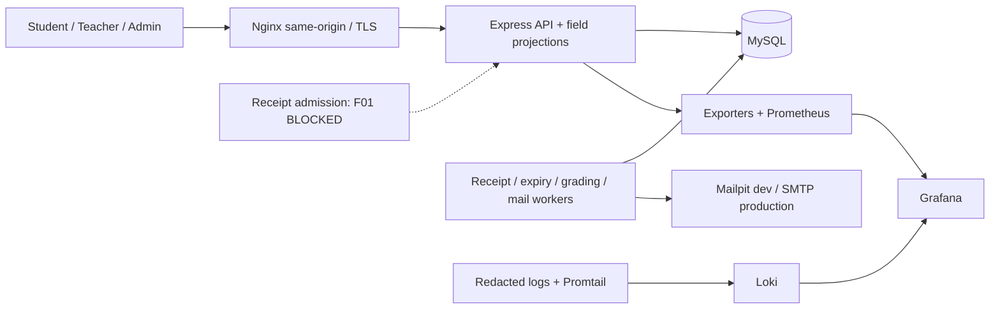
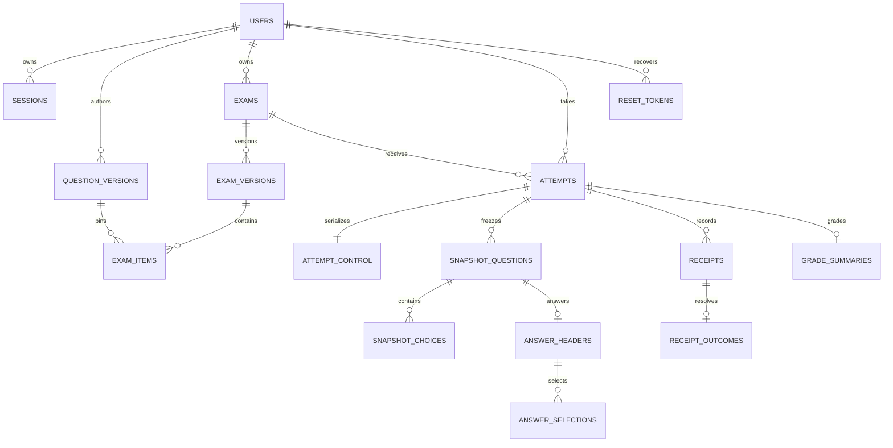

# QuizSystem — Design Baseline R8 / Master V1.0

Ngày: 2026-10-22, Asia/Saigon. Phase 01 / Design Batch 01. Gate 01-A: **BLOCKED**.

Đây là tài liệu thiết kế thống nhất. Nó thay thế các mô tả kỹ thuật R7/R8 trước trong phạm vi được ghi dưới đây, không thay BD/TC đã duyệt. Không có application source, dependency, migration hoặc container nào được tạo/chạy trong E1. [PREFLIGHT.md](PREFLIGHT.md) chứa bằng chứng môi trường; [openapi.yaml](openapi.yaml) là API design, không phải server đang hoạt động.

## 1. Thẩm quyền và bằng chứng

Thứ tự: PDF/rubric cho yêu cầu môn học; BD-01..13 và phê duyệt trực tiếp; artifact đã xác minh; IA01; đề xuất mới. Không dùng PASS tự đánh giá của R7 làm bằng chứng.

Phân loại: APPROVED = chính sách có nguồn; PDF_REQUIRED = yêu cầu gốc; DESIGN_REQUIRED = cơ chế để thực hiện baseline; PROPOSED = lựa chọn chưa phê duyệt. RESOLVED_BY_DESIGN không phải CLOSED hoặc runtime PASS. Mọi case chưa chạy có actual=NOT_RUN và status=BLOCKED trong acceptance matrix.

PDF: `C:\Users\hoang\OneDrive\Desktop\De_Tai_Thuc_Hanh - TKQT HTPM K23.pdf`, trang 1–2 và 10. Excel: `C:\Users\hoang\OneDrive\Desktop\ĐỀ TÀI.xlsx`, sheet `K23.K1.CNTT K23G`, C46/E46/K46. Handoff baseline và R7: xem PREFLIGHT. US/AC gốc, implementation DDL và runtime evidence: MISSING EVIDENCE; các US/AC dưới đây được soạn mới và có nhãn riêng.

## 2. Approved baseline và quyết định

| ID | Nội dung thẩm quyền | Nguồn/trạng thái |
|---|---|---|
| BD-01 | Student/Teacher tự đăng ký, active ngay; không verification/invite/admin approval bắt buộc | Supplement 02 / APPROVED |
| BD-02 | Admin quản trị accounts/roles/status/config; không academic CRUD hoặc sửa grade | Supplement 02 / APPROVED |
| BD-03 | Freeze assessment-affecting content/config khi có attempt; clone/version để đổi; bảo toàn lịch sử | Supplement 02 / APPROVED; không blanket freeze metadata |
| BD-04 | Multiple choice exact-set all-or-nothing | Supplement 02 / APPROVED |
| BD-05 | Offline buffer; local/server ACK riêng; không nhận dữ liệu mới sau hạn | Supplement 02 / APPROVED |
| BD-06 | Score/key publication độc lập | Supplement 02 / APPROVED |
| BD-07 | Browser-independent finalization/recovery | Supplement 02 / APPROVED |
| BD-08 | Positive weights, raw + scale 10, hai chữ số hiển thị, exact arithmetic | Supplement 02 / APPROVED; rounding rule chưa duyệt |
| BD-09 | Một active/student/exam, resume, max attempts | Supplement 02 / APPROVED |
| BD-10 | Public và Assigned thuộc P0 | Supplement 02 / APPROVED |
| BD-11 | Email reset, expiring hashed single-use token | Supplement 02 / APPROVED |
| BD-12 | Immutable prompt/choices/keys/weights snapshot | Supplement 02 / APPROVED |
| BD-13 | Attempt và grading lifecycles riêng | Supplement 02 / APPROVED |
| TC-01B | Admin metadata + aggregates phù hợp; không questions/keys/answers/individual grades ngoài quyền | Supplement 02 / APPROVED |
| BD11-P2 | Reset P0; Mailpit dev, SMTP thực production | Supplement 02 / APPROVED |
| TC-D | D=min(started_at+duration,exam.end_time), không grace | Supplement 02 / APPROVED |
| R8-D01..08 | Trusted full body; durable receipt commit trước D; ACK sau commit; immutable ID/digest; lost ACK reconciliation; barrier; no backdate | Phê duyệt trong hội thoại / APPROVED |
| R8-D09 | SAVE/SUBMIT theo thứ tự server nhận đủ payload; valid SUBMIT đầu khóa bài | Người dùng: “Duyệt quy tắc submit này” / APPROVED |
| R8-D10 | Batch conflict từ chối cả batch và SUBMIT, không khóa bài | Cùng phê duyệt / APPROVED |
| SESSION | Natural expiry không hủy receipt; lock/hard revoke/reset có hiệu lực trước apply làm từ chối; không sửa ngược outcome | Phê duyệt trực tiếp / APPROVED |
| INCIDENT | Giữ attempt blocked; Teacher owner + kỹ thuật đối soát; bỏ receipt/hủy/cấp bù phải duyệt riêng; Admin metadata only | Phê duyệt trực tiếp / APPROVED |
| EXEC | Được ghi design docs; source/deps/tests/Docker/DB/Git commit cần quyền riêng | Master V1.0 / APPROVED |

Master yêu cầu phân biệt normal reset và security reset. Tài liệu ghi `reset_reason=NORMAL|SECURITY` để audit nhưng không tự tạo khác biệt quyền lợi: cả hai vẫn tăng auth_epoch theo phê duyệt reset trước đó. Nếu muốn normal reset bảo toàn pending receipt thì đó là policy change, chưa APPROVED. DR-F01-CHANGE trước đây **NOT APPROVED**, không triển khai.

## 3. Kiến trúc và phạm vi triển khai độc lập

Stack giữ HTML/CSS/vanilla JS, Node/Express, MySQL/phpMyAdmin, Nginx, Compose, Prometheus/Grafana, Loki/Promtail, Mailpit. API và static frontend cùng origin qua Nginx. DB và workers không public Internet. Không thay stack do package/runtime tạm thời trên máy.



E2 độc lập: accounts/auth/reset, ownership/RBAC, immutable bank/exam authoring, metadata/publication administration, grade worker logic với sealed fixtures. Giao diện học thuật chỉ gọi API thật khi backend có quyền triển khai; không giả lập lưu thành công.

F01 block: production admission, answer writes, submit/expiry end-to-end, student grading end-to-end. Feature gate server-side phải từ chối các đường phụ thuộc; không tạo attempt mới nếu chưa có admission hợp lệ để tránh tiêu lượt. Đây là implementation safety gate khi chuẩn bị module, không thay chính sách exam. API đọc, authoring và auth vẫn có thể hoạt động. Không bypass bằng demo receipts trong môi trường dùng thật.

## 4. Dữ liệu / ERD / schema specification

### 4.1. Entities

| Entity | Fields/keys chính | Integrity |
|---|---|---|
| users | id, normalized_email, password_hash, role, status, credential_version, auth_epoch | Unique normalized email; role Student/Teacher/Admin; self-registration không Admin |
| sessions | id_hash, user_id, csrf_hash, auth_epoch, revocation_generation, expires_at, revoked_at/reason | Không lưu raw cookie; giữ chứng cứ phân biệt expiry/revocation khi receipt còn cần |
| question_versions | id, teacher_id, logical_question_id, kind, prompt, version | Immutable version; kind SINGLE/MULTIPLE; choices/keys private |
| question_choices | question_version_id, choice_id, text | Composite PK |
| question_keys | question_version_id, choice_id | FK choices; server-only |
| exams / exam_versions | exam_id, teacher_id, version_id, assessment config | Owner FK; CAS edit_revision; assessment lock sau attempt |
| exam_items | exam_version_id, ordinal, question_version_id, weight_exact | Unique ordinal; positive weight |
| assignments | exam_id, student_id | Composite unique; changes under exam X lock |
| attempts | id, exam_id, student_id, attempt_number, started_at, deadline_at, status, grading_status, input_revision | Unique active slot + ordinal; immutable exam_version |
| snapshot_questions | attempt_id, snapshot_question_id, prompt, kind, weight_exact, ordinal | Immutable composite PK |
| snapshot_choices / snapshot_keys | attempt_id, question_id, choice_id, text / key marker | FK question; keys never in Student initial projection |
| attempt_control | attempt_id, ingress_owner, epoch, next_seq, cursor, gate, high_watermark, submit_receipt_id, incident flag | One per attempt; lock before attempt row |
| receipts | id, actor_id, attempt_id, request_id, operation, writer_id, client_seq, digest, payload, durable_seq, session context | Unique actor/attempt/request; unique attempt/seq; immutable payload |
| admission_evidence | receipt_id, authority_identity, clock_epoch, evidence, conclusion | F01 mechanism unresolved; no invented commit timestamp |
| receipt_outcomes | receipt_id, outcome, reason_code, resulting_revisions | One terminal outcome per receipt |
| writer_progress | attempt_id, writer_id, actor_id, last_processed_seq | Registered writer; revision controls cross-writer races |
| answer_headers | attempt_id, question_id, revision | One per snapshot question, absent means revision 0 |
| answer_selections | attempt_id, question_id, choice_id | Unique selection and composite snapshot-choice FK |
| grading_jobs | attempt_id, executions, generation, owner_execution_id, lease_until, next_eligible_at | One job per attempt; immutable grading input reference |
| grade_summaries / grade_details | attempt_id; attempt/question | One final result; raw/max exact values, normalized representation |
| reset_requests / reset_tokens | request_id; token_hash, user_id, generation, expiry, used_at | Issuance idempotency; latest-issued generation; no plaintext secret |
| mail_outbox | id, issuance_id, ciphertext, key_reference, delivery state/owner | No SMTP in issuance transaction; encrypted transient delivery secret |
| publications | exam_id, scores_published, keys_published, revision | Independent flags; backend projection |
| incidents / audits | opaque IDs, category, actor, event, timestamps, resolution refs | Metadata-only operational views; academic evidence separate ACL |
| operation_results | actor_id, operation scope, request_id, digest, result ref | Idempotent Start/clone/administrative mutations |

Exact decimal precision/range and rounding are pending; no implicit DECIMAL(5,2) or floating-point score. IDs/revisions/counts in JSON are decimal strings where JS Number could lose precision. Time values use UTC representations; storage precision and clock semantics must be verified.



### 4.2. Constraint fragments (design only; not executed)

```sql
active_slot GENERATED ALWAYS AS
  (CASE WHEN status='IN_PROGRESS' THEN 1 ELSE NULL END) STORED;
UNIQUE(student_id, exam_id, active_slot);
UNIQUE(student_id, exam_id, attempt_number);
UNIQUE(actor_id, attempt_id, request_id);
UNIQUE(attempt_id, durable_seq);
PRIMARY KEY(attempt_id, question_id); -- answer header
PRIMARY KEY(attempt_id, question_id, choice_id); -- answer selection
FOREIGN KEY(attempt_id, question_id)
  REFERENCES snapshot_questions(attempt_id, question_id);
FOREIGN KEY(attempt_id, question_id, choice_id)
  REFERENCES snapshot_choices(attempt_id, question_id, choice_id);
PRIMARY KEY(receipt_id); -- receipt outcome
PRIMARY KEY(attempt_id); -- final grade summary
```

All non-generated unique-key components NOT NULL. No cascade deletion of attempt/snapshot/receipt history. Index scheduler state+due time, receipts attempt+seq, session/user, reset token hash, outbox due time. Logical archive instead of physical delete where referenced. No schema migration executed.

## 5. Transaction authority

Design choice: InnoDB READ COMMITTED; current locking reads and explicit serialization, not assumed phantom immunity. Global order: users → sessions/revocation records → exam → attempt_control → attempt → receipt/job/token/operation → answer headers → selections/result details/outbox. Multiple rows same rank: ascending IDs. Grading uses attempt/job and never locks backwards. Mail outbox claim commits before any user lookup/network call. No SMTP/network call inside business transactions.

Deadlock/lock timeout: explicit full ROLLBACK; bounded configured transaction retry of same operation identity. COMMIT unknown: primary reconciliation first, not blind retry. A SELECT timestamp that began before lock wait is not fresh for post-lock decisions. Use new standalone time statement after locks, not a stale stored variable. Parameters are not defaults. DB clock faults block time-sensitive decisions.

### C-ADM: admission (F01 BLOCKED)

Authoritative requirements: trusted full body R; durable receipt commit C; deadline D; require R≤C<D. Answer application A may be ≥D. Client timestamp is never evidence. Immutable payload/digest/sequence/context must survive with receipt; no ACK before commit.

H1: precommit timestamp<D, C<D, crash before postcommit evidence. H2: same precommit timestamp, C>D, same crash. Persisted payload and precommit time can be indistinguishable. Existing MySQL design has no verified mechanism distinguishing H1/H2. `created_at`, NOW before COMMIT, binlog fields named commit_timestamp and mere row visibility do not establish post-durability time. Postcommit witness before D proves a subset but its loss leaves the gap. **No alternate semantics selected. DR-F01-CHANGE remains NOT APPROVED.**

`admit` must return ADMITTED only with valid evidence; otherwise REJECTED only if conclusively rejected, or ADMISSION_UNCERTAIN. Unknown blocks order/finalization; not discarded due timeout/retry count. Queue notifications are hints; DB receipts/outcomes are authoritative recovery records. No partial ACK.

### C-ORDER: authority and durable sequence

One trusted ingress owner per attempt, with a serialized full-body callback establishing receive_order before asynchronous validation/DB waits. FIFO append; later requests cannot overtake a head waiting on DB. In one control-row transaction verify owner+epoch+open gate, check request_id/digest, allocate next_seq, INSERT immutable receipt, increment next_seq, COMMIT. Request key excludes operation so SAVE→SUBMIT substitution is a conflict. An uncertain commit stops append until reconciled.

Atomic counter allocation alone does not prove receive order. Durable order is the persisted projection of receive order for surviving receipts. Crash loses unreceipted memory requests within approved recovery boundary; retry is a new reception unless same durable receipt exists. Never reconstruct old position from client/log timestamp. Handoff fences old owner, resolves old transaction, recovers sequence/cursor before accepting. Two independently writable primaries with matching epoch values are not safe fencing; fail closed on unverified failover/split brain.

### C-START: start/resume

BEGIN RC → lock user/session; validate current role/status/security → exam FOR SHARE → lookup Start operation identity → existing operation returns same attempt even if it later ended → current active attempt returns same attempt (read-only processing status if gate closed/incident) → otherwise check Public/Assigned under exam lock → count all existing attempts while user lock held → enforce configured finite max → allocate max ordinal+1 → fresh start time and D → insert attempt/control/full pinned snapshot + operation result → COMMIT → response.

All Start paths use user serialization; Public does not need an assignment row. Assignment writes take exam X lock. Unique active slot is second defense. Failed snapshot transaction leaves no attempt. Start must not directly expire old attempt. C-FIN may run separately before Start retry; committed finalization is not rolled back when subsequent Start exceeds max. With unresolved F01, creating a new live attempt is unavailable instead of consuming a student's attempt.

Teacher edit pins new immutable question versions under exam X lock. Student snapshot copies one exam version under S lock. Bank edits never mutate pinned versions. Do not allow mixed content/key/weight versions.

### C-SAVE: receipt processing

Payload: request_id, operation SAVE|SUBMIT, writer_id, client_seq, items(question_snapshot_id, expected_revision, selected_choice_ids). Duplicate questions/choices rejected. Choices must belong to exact snapshot question. SINGLE ≤1 selection; MULTIPLE selections all valid. Empty selection clears answer; no mandatory-answer policy invented. SAVE requires items; SUBMIT can have no batch. First insert requires expected_revision=0. All batch revisions must match or entire batch rejects. Per-writer sequence strictly advances; no jump limit 100. Across writers use expected_revision. Same request/digest retry returns original outcome before stale check; same request/different digest CONFLICT.

BEGIN → user/session locks → control → attempt → next receipt → existing outcome returns existing → require next durable order and proven admission → unknown blocks → if prior valid submit reject ALREADY_SUBMITTED → enforce hard revocation epochs → validate all payload/revisions before writing → rejection writes one final reason, no answer change → success replaces all selections, increments revisions, writes outcome → valid SUBMIT also sets submit_intent, freezes answers, closes gate and captures high-watermark N atomically → advance cursor → COMMIT. Sequence watermark advances for structurally valid newly processed sequence even on revision conflict; retrying a corrected payload uses new request/seq. Infrastructure exception rolls back answers/outcome/cursor together.

### C-FIN: cutoff/finalization

Expiry closes gate and records N under control lock; any old appender is resolved/fenced before barrier is final. No answers accepted via new request after cutoff. Evidence updates for an existing receipt cannot change payload or append a new one.

BEGIN → control → attempt → if terminal return same result → require closed gate, no uncertain transaction/incident, no old writer, every receipt through N resolved, cursor=N → SUBMITTED if valid submit_intent else EXPIRED only after D → seal answer revision set → grading PENDING_GRADING → unique grading notification/outbox → COMMIT. Worker scans committed pending state if notification lost. No NOW-only expiry UPDATE. One unresolved earlier receipt blocks later submit/finalization.

### C-GRADE: bounded execution and fencing

Parameters R≥0 retries, B=R+1 maximum claims, lease L>0; values pending. No heartbeat selected for initial design. Grading input immutable and identified by revision.

Claim: BEGIN → lock attempt/job → fresh time → require terminal/sealed attempt and PENDING_GRADING due → if count≥B and no owner, fail terminal → else count++, generation++, fresh execution owner ID, lease_until=now+L, GRADING → capture owner/generation/input revision under lock → COMMIT → only then compute. Never claim by separately reading latest token.

Complete: BEGIN → lock attempt/job → fresh time → require GRADING + captured owner/generation/input revision + lease not expired → insert all detail+summary rows → fresh time check again → set GRADED, clear owner → COMMIT. Result PK prevents duplicates. Completion transition linearizes under row lock; COMMIT may finish after lease while reclaimer waits. Lease expiration permits reclaim, not concurrent overwrite of a locked validated completion. This is not a wall-clock physical-commit guarantee.

Failure/reclaim: BEGIN → lock attempt/job → worker exception requires captured ownership; scheduler requires expired lease; never terminalize live owner merely because count=B → invalidate generation, clear owner → count<B means PENDING_GRADING with finite configured backoff; otherwise GRADING_FAILED → outbox alert → COMMIT. Reclaim does not increment count again; next claim does. Stale exception is no-op. No automatic FAILED→PENDING; manual recovery policy pending.

Safety: stale worker lacks owner/generation, cannot commit; cannot acquire new ownership by reading token. Crash before result commit rolls back all details. Lost ACK returns existing GRADED result. Exactly-once execution is not claimed. Liveness assumes DB/scheduler recover, clock advances, locks eventually end and finite backoff: at most B executions then GRADED/FAILED. Infinite DB outage/hung locks excluded explicitly.

### C-AUTH / C-RESET

Self-registration role allowlist Student/Teacher, active immediately, unique normalized email; reject Admin role, unknown privileged fields. Admin bootstrap separate operator-controlled command after execution permission, no default credentials. Password algorithm/parameters assessed before install; no weak fallback. Session opaque random secret hashed at rest; cookie Secure/HttpOnly/host-only, SameSite defense plus CSRF token and origin checks. Same-origin HTTPS required for secure cookie development integration; no silent insecure cookie fallback. Public auth mutators also use pre-auth CSRF/origin defense.

Login reads hash/version, verifies outside lock, then user lock rechecks status/version before inserting session with current auth_epoch. Reset changing version in between defeats old-password session creation.

Forgot endpoint uniform accepted message and asynchronous request handling for existent/nonexistent email; rate limit identity independent of existence; no account lock from forgot spam. Issue under user lock: idempotent reset request → generation++ invalidates old generation → insert expiring hashed random token and encrypted delivery outbox → COMMIT. Selected newest-issued policy is technical PROPOSED, not mislabeled original approval. Transient secret encrypted with external key, no plaintext DB/log. Token TTL pending.

Consume: hash new password outside transaction → user lock → token lock → fresh time → validate hash/unused/current generation/not expired → consume once + replace password + credential_version++ + auth_epoch++ + session revocations + invalidate other reset tokens → COMMIT. No auto-login. Concurrent consume: one success. Concurrent issue/consume serialized by user lock. Both NORMAL/SECURITY reset recorded distinctly, both revoke under current approved baseline. Security-reset extra compensation not invented.

SMTP outside transaction. Reuse same issued token across mail retries; generation check prevents old email authorizing reset. SMTP accepted+ACK lost is delivery uncertainty; duplicate email possible; no exactly-once email or DB rollback recalling sent mail. Outbox ciphertext removed after delivery/no longer needed/expiry according to pending retention. Mailpit development only, real SMTP production separately configured.

Natural session expiry during pending receipt processing is not hard revocation. Keep receipt-linked expiry/revoke history. Apply uses user/session locks and captured epochs: lock/revoke/reset effective before apply rejects with final reason/audit. Lock then unlock does not restore old epoch. Already committed outcomes are unchanged. Receipt lookup after re-login requires same user ownership, not possession of request ID alone.

## 6. State machines and invariants

| Lifecycle | Allowed transitions | Authority |
|---|---|---|
| Attempt | none→IN_PROGRESS | C-START |
| Attempt | IN_PROGRESS→SUBMITTED | C-FIN + submit intent + barrier |
| Attempt | IN_PROGRESS→EXPIRED | C-FIN + deadline + barrier |
| Grading | NOT_APPLICABLE→PENDING_GRADING | Same finalization transaction |
| Grading | PENDING_GRADING→GRADING | Atomic bounded claim |
| Grading | GRADING→GRADED | Fenced atomic completion |
| Grading | GRADING→PENDING_GRADING | Failure/expired lease, budget remains |
| Grading | GRADING→GRADING_FAILED | Failure/expired lease, exhausted |
| Grading | PENDING_GRADING→GRADING_FAILED | Exhausted orphan pending state, no valid owner |

No additional business enums. Technical incident/admission/receipt states have separate tables. SUBMITTED/EXPIRED/GRADED terminal; FAILED not automatically retried. Submit intent freezes answers before finalization; not a new attempt status.

Invariants: one active attempt/student/exam; finite max not exceeded; snapshot immutable; immutable request identity/digest; receive order preserved among durable receipts; atomic batches; first valid submit freezes; no finalize before barrier; one committed receipt outcome; one committed grade; stale workers fenced; session hard revoke enforced; field projections across API/export/cache/log. Durable-commit-before-D invariant remains unproved F01.

## 7. RBAC, publication, frontend and privacy

| Role/resource/action | Ownership/state | Field rule |
|---|---|---|
| Admin accounts/roles/status/config | Management scope | No hashes/tokens/session credentials; no academic write |
| Admin exam metadata | Any administratively visible exam | Allowlisted ids/owner/status/config metadata; no prompt/choices/keys |
| Admin incidents | Metadata-only | Category/state/opaque references; no receipt payload or individual grades |
| Admin aggregates | Approved operational scope | Counts/job health allowed design; academic score-query policy pending, not blanket aggregate ban |
| Teacher bank/exam CRUD/clone | Own resources | Assessment edits frozen after attempts; clone new version |
| Teacher publication/export/review | Own exam; review-state policy explicit | No auth secrets; exports use same data scope; live review permission pending |
| Student start/resume/save/submit | Own attempt + eligibility | Snapshot/own selections only; depends on admission gate |
| Student history/result | Own finalized attempt | Four publication projections below |

Publication matrix (always own attempt, no grade before finalized+GRADED):

| Score flag | Key flag | Allowed fields |
|---|---|---|
| false | false | Attempt metadata and own selections; no grade/correctness/keys |
| true | false | Add total raw/normalized/max score; no per-question awarded score/correctness/keys |
| false | true | Add correct-choice set; no grade fields |
| true | true | Add score and keys; per-question review within projection |

Keys+weights+own selections can enable score inference even when score flag false. Independent flags control direct disclosure; mathematical inference cannot be promised away. Pending policy is documented, not used to merge flags. Student list/exam endpoint never carries server-only snapshot keys. Server projections not front-end hiding. private/no-store for sensitive responses; exports reauthorize at generation and download; cache keys include scope/publication revision where caching is permitted. No promise to retract downloaded data on unpublish.

Assessment-affecting fields frozen; pure admin metadata not blanket frozen. Prompt/description with assessment instructions treated as assessment content. Publication controls separate. No cross-Teacher object access or role union bypass. SQL parameterized; HTML text rendering uses textContent and sanitization for any explicitly supported markup; no unsanitized question HTML. CSP/security headers and output encoding included, not called complete XSS prevention.

Frontend routes: public login/register/forgot/reset; Student catalog/exam/history/result; Teacher bank/exam editor/distribution/attempts/publication; Admin accounts/metadata/health. Offline IndexedDB namespace user+attempt+writer; pending payload holds no key, cookie or reset secret; logout/account switch purges applicable local data and broadcasts stop-sync. Multi-tab/device permitted with optimistic revision; no single-writer session policy. Display Local saved / Received durable / Saved to attempt distinctly; blocked admission displays unavailable, no fake success.

Logs allow event/category/correlation/duration/state/generation metadata only. No passwords, cookies, email bodies/reset links, answers, keys, raw payload, individual grades in operational logs. Incident technical evidence protected separately; Admin incident access does not grant DBA/academic access. Metrics labels never student/attempt/token values. Score buckets/delay/k alone not claimed to prevent differencing or homogeneous-cohort inference.

## 8. API contract

OpenAPI design in `openapi.yaml`; it lists auth, questions, exams/assignments/clone/publication, attempts/answers/submit/receipt/result/history, Admin metadata/accounts/stats/incidents, health. New evidence is required before removing F01 blocker markers. `additionalProperties:false` for mutation payloads to prevent privileged-field injection. IDs/revisions/scores serialized without JS floating-point loss. Every mutator validates ownership server-side and cookie/CSRF/origin where applicable. Error bodies contain code+correlation ID, no SQL/stack/secrets.

Request identity headers on idempotent create/clone/start; answer request_id in immutable envelope. Ownership failure uses consistent non-enumerating response where suitable; no hidden-resource payload. 202 receipt ACK distinct from 200 answer outcome. 503 DESIGN_BLOCKED not misreported as DEADLINE_EXCEEDED or successful receipt. No new operation can exploit retry path after D.

## 9. Infrastructure design (not executed)

Compose services: nginx, app, workers, mysql, phpmyadmin, prometheus, grafana, loki, promtail, mailpit(dev), plus DB/container/web exporters needed for rubric. Selected exact image versions/digests require compatibility/security review before image pull; no latest tags assumed. Restart/healthchecks and depends_on do not replace application retry/readiness.

Networks: edge (Nginx/app), data internal (app/worker/MySQL/phpMyAdmin), observability internal. No public DB port. DB tool/dashboard/Mailpit bound to localhost/authenticated dev access only. Nginx only intended public service, no Internet exposure without approval. Avoid broad Docker socket access; exporter/socket visibility reviewed explicitly. Persistent named volumes separate DB/Grafana/Prometheus/Loki state. Proposed dedicated dev project, never reuse unknown volumes.

Secrets: runtime external environment/secret files, excluded from Git; templates placeholders only; no seed passwords in repository. Non-root app where supported; read-only filesystem with explicit writable temp; drop unnecessary capabilities; least-privilege DB accounts, migration user separate. TLS local certificate needed for Secure cookies; certificate generation also waits for execution permission. No host/system/service change made.

Metrics: web latency/errors; DB availability/connections; container resource health; receipt backlog/age/uncertainty; grading pending/lease/retry/failure; mail delivery uncertainty. Logs redacted before Promtail reads. Proposed LogQL verification queries: `{service="quiz-api"} | json | event="request_complete"`; `{service="quiz-worker"} | json | event="grading_failed"`; `{service="quiz-worker"} | json | event="admission_uncertain"`. Query fields must match emitted allowlist; no evidence fabricated.

Promtail vendor EOL is 2026-03-02 (verified official docs); retain requested Promtail stack for rubric, record unsupported component risk; no unapproved switch to Alloy. Production readiness cannot be claimed merely from a development demo.

## 10. FR–US–AC traceability

All US/AC texts below are newly authored PROPOSED acceptance detail. Source requirement classification is separate. Original US/AC mapping MISSING EVIDENCE. Contract references above are authoritative definitions, not copied alternate rules.

| Requirement/source/class | User story | Acceptance detail + positive/negative/security/concurrency | Evidence/status |
|---|---|---|---|
| FR-CORE-01 PDF p10 PDF_REQUIRED | Teacher creates quiz | Save valid exam atomically; reject foreign question/invalid weight; edit/start sees one version | C-START/RBAC; T06,T07,T08; NOT_RUN |
| FR-CORE-02 PDF p10 PDF_REQUIRED | Student takes own quiz | Start/resume same active; reject foreign attempt; competing starts one active | C-START; T09–T12; BLOCKED F01 |
| FR-CORE-03 PDF p10 PDF_REQUIRED | Auto-grade finalized quiz | Exact sets full weight else zero; stale owner no result; crash no partial grade | C-GRADE; T23–T27; NOT_RUN |
| FR-AUTH-01 BD01 APPROVED | Student/Teacher self-register | Active without email approval; reject Admin injection; duplicate email unique under race | C-AUTH; T01,T02; NOT_RUN |
| FR-AUTH-02 DESIGN_REQUIRED | Secure login/session | Valid credentials session; wrong password generic; reset races invalidate old verify; CSRF enforced | C-AUTH; T03,T04,T05,T31; NOT_RUN |
| FR-AUTH-03 BD11/P2 APPROVED | Recover password | Expiring hashed single-use token; concurrent consume one success; SMTP uncertainty not false rollback | C-RESET; T28–T32; NOT_RUN |
| FR-USER-01 BD02/TC01B APPROVED | Admin manages users | Roles/status changes guarded; no academic write/read leakage; lock impacts pending receipts | C-RBAC/AUTH; T33,T34,T35; NOT_RUN |
| FR-BANK-01 PROPOSED organization | Teacher reuses own questions | CRUD owned versions; reject foreign resources; edit never changes prior snapshot | C-START/RBAC; T06,T07; NOT_RUN |
| FR-EXAM-02 BD03 APPROVED | Teacher clones assessment | New exam identity/version; old snapshot unchanged; frozen edits rejected | C-START; T08; NOT_RUN |
| FR-EXAM-03 BD10 APPROVED | Public/Assigned access | Public works without assignment row; missing assignment denied; locked eligibility race | C-START; T10; NOT_RUN |
| FR-EXAM-04 BD06 APPROVED | Publish score/key separately | All four projections; Teacher ownership; cache/export do not bypass flags | C-RBAC; T36,T37; NOT_RUN |
| FR-TAKE-04 BD07/TC-D APPROVED | Auto-expiry | Browser absent still cutoff; no finalize pending/unknown receipt; no premature grading | C-ADM/FIN; T19,T20,T21; BLOCKED F01 |
| FR-TAKE-05 BD07/13/D09/10 APPROVED | Submit safely | First valid submit freezes; conflict batch rejects entirely; later saves denied; duplicate no reapply | C-SAVE/FIN; T16–T18; BLOCKED F01 |
| FR-HIST-01 BD12 APPROVED | Stable exam history | Snapshot all prompt/choices/keys/weights; composite FK; version edits not historical mutations | C-START/schema; T07,T13; NOT_RUN |
| FR-OFFLINE-R8 BD05 APPROVED | Offline sync honestly | Local/server/apply ACK distinct; membership/cardinality/revision validation; no client-time rescue | C-SAVE/SEC; T13–T15,T38; BLOCKED F01 |

## 11. Acceptance matrix and execution records

Every case currently: Actual=NOT_RUN, Status=BLOCKED, Evidence=none. Reason PERMISSION unless F01 indicated. No PASS assigned. After authorization tests must record command/environment/revision, actual response/state and redacted evidence. New evidence locations created only when execution permitted. Static document review is not automated test execution.

| Test | Requirement/finding | Scenario / expected result | Current blocker |
|---|---|---|---|
| T01 | AUTH01 | Student/Teacher register active; email not verified requirement | PERMISSION |
| T02 | AUTH01/F10 | Inject Admin/extra fields; no elevated account; race email one identity | PERMISSION |
| T03 | AUTH02 | Login good/bad; generic errors; session cookie flags | PERMISSION |
| T04 | AUTH02/F07 | CSRF/origin absent/foreign rejects mutations | PERMISSION |
| T05 | AUTH02/F09 | Old password verification concurrent reset cannot create new valid session | PERMISSION |
| T06 | CORE01/F10 | Teacher own question CRUD; foreign Teacher denied | PERMISSION |
| T07 | HIST01/F03 | Bank edit/delete cannot mutate referenced version/snapshot | PERMISSION |
| T08 | EXAM02/BD03 | Clone new identity; assessment edit frozen; metadata classification respected | PERMISSION |
| T09 | CORE02/F03 | Two Start requests → one active, same resume; idempotent lost ACK same attempt | PERMISSION + F01 live path |
| T10 | EXAM03/F03 | Public no assignment row; Assigned denial; eligibility/start race | PERMISSION |
| T11 | CORE02/F03 | Final allowed attempt boundary never exceeded | PERMISSION |
| T12 | CORE02/F02 | Start rejected after separately committed expiry does not undo expiry | PERMISSION + F01 |
| T13 | HIST01/F06 | Wrong snapshot/choice/duplicate choice/cardinality rejected atomically | PERMISSION |
| T14 | OFFLINE/F06 | First insert rev0; cross-device same rev second conflicts; no partial batch | PERMISSION + F01 |
| T15 | OFFLINE/F06 | Same ID/digest replay old outcome; changed payload/operation conflicts; stale sequence | PERMISSION + F01 |
| T16 | TAKE05/F02 | SAVE before SUBMIT lock wait never overtaken | PERMISSION + F01 |
| T17 | TAKE05/F02 | SUBMIT batch conflict rejects all, no freeze, next SAVE possible | PERMISSION + F01 |
| T18 | TAKE05/F02 | Valid SUBMIT first freezes; later SAVE denied; duplicate submit no duplicate effect | PERMISSION + F01 |
| T19 | TAKE04/F01 | H1/H2 after crash must be distinguished without precommit timestamp | F01 DESIGN BLOCKED |
| T20 | TAKE04/F02 | Pending/unknown receipt prevents expiry/finalization/grading | PERMISSION + F01 |
| T21 | TAKE04/F01 | Lost receipt ACK/restart/partition reconciles; no backdate | PERMISSION + F01 |
| T22 | TAKE05/F02 | Two finalizers one terminal transition and unique grading notification | PERMISSION + F01 |
| T23 | CORE03/F04 | Two grading claimers: one captured owner/generation | PERMISSION |
| T24 | CORE03/F04 | Reclaim then old worker completes/reads new token: no result | PERMISSION |
| T25 | CORE03/F05 | SIGKILL and caught exceptions consume same finite budget; terminal failure | PERMISSION |
| T26 | CORE03/F05 | Live final-budget owner not terminalized before expiry | PERMISSION |
| T27 | CORE03/F04 | Crash mid-details rolls back; lost COMMIT ACK returns one grade; exact-set scoring | PERMISSION |
| T28 | AUTH03/F08 | Expired/used/rotated token rejected; simultaneous consumes one success | PERMISSION |
| T29 | AUTH03/F08 | Concurrent issuances/consume serialize latest generation; idempotent issue | PERMISSION |
| T30 | AUTH03/F09 | SMTP reject/timeout/accepted ACK lost; DB not falsely rolled back; no raw token logs | PERMISSION |
| T31 | AUTH03/F07 | Natural expiry preserves admitted receipt; hard revoke/lock/reset rejects before apply | PERMISSION + F01 |
| T32 | AUTH03/F09 | Forgot existent/nonexistent same response; rate limit; Mailpit not production provider | PERMISSION |
| T33 | USER01/F10 | Student/Teacher/Admin IDOR and role escalation rejected | PERMISSION |
| T34 | USER01/F10 | Admin metadata/incidents no question/key/answer/individual-grade fields | PERMISSION |
| T35 | USER01/F10 | Admin allowed operational aggregates work; disallowed academic filters denied | PERMISSION |
| T36 | EXAM04/F10 | Four publication projections field-by-field; no per-item correctness before keys | PERMISSION |
| T37 | EXAM04/F10 | Export/cache reauthorize; Teacher ownership; no public result URL leakage | PERMISSION |
| T38 | OFFLINE/F07 | Account switch/multi-tab never syncs other user's pending data; XSS text encoding | PERMISSION |
| T39 | INFRA | Dev services healthy, Nginx routes, DB connection, guarded phpMyAdmin | DOCKER/DB PERMISSION |
| T40 | METRICS | Prometheus web/container/DB targets, Grafana real dashboard, no PII labels | DOCKER PERMISSION |
| T41 | LOGGING | Promtail→Loki; 3 documented LogQL queries; no secrets/academic content | DOCKER PERMISSION |
| T42 | HARDENING | TLS/headers, nonroot, internal network, restricted DB privileges, no public DB | DOCKER PERMISSION |
| T43 | RECOVERY | DB restart/lock timeout/duplicate retry explicit rollback and reconcile | DOCKER/DB PERMISSION |
| T44 | SOURCE | Repo/README/3 meaningful commits/report/demo match original rubric | IMPLEMENTATION/GIT PERMISSION |

## 12. Rubric traceability

All PDF_REQUIRED. Owners below are proposed responsibilities, not claimed appointed people. Planned execution after permission, not a demand to run infrastructure in Design Batch 01.

| ID / points | Required artifact / AC | Planned phase / owner | Evidence and current state |
|---|---|---|---|
| RUB01 / 1.5 | GitHub source/config, README clear run steps, 3 meaningful commits; account/name per student ID | E2–E8 / implementer | Git URL/history/README; not created, Git mutations not authorized |
| RUB02 / 1.5 | Real quiz web + MySQL + phpMyAdmin functioning | E2–E6 / backend+DB | T01..38,T39; no implementation |
| RUB03 / 1.5 | Nginx reverse proxy + HTTPS or security headers | E5–E6 / infrastructure | T39,T42 + configuration/HTTP evidence; not run |
| RUB04 / 1.5 | Prometheus metrics container/web/DB + Grafana dashboard | E5–E6 / observability | T40 actual targets/dashboard; not run |
| RUB05 / 1.5 | Loki+Promtail, 2–3 usable LogQL queries | E5–E6 / observability | T41 log ingestion and query results; EOL risk open |
| RUB06 / 1.5 | At least 3–4 hardening measures | E2–E6 / security+infrastructure | T04,T33,T42 permissions/headers/network evidence; not run |
| RUB07 / 1.0 | All services Compose, report≥10 pages with student/topic cover, architecture/results/images, complete demo | E7–E8 / implementer | Compose/report/demo/screenshots; not produced |

Total 10.0 rubric points specified; **no points awarded or claimed**. Readiness/coverage planned only.

## 13. Decision register and risks

| ID | Content / source / effect | Options and recommendation | Approval |
|---|---|---|---|
| DR-ADM | Durable receipt C<D, user decisions | Keep approved physical semantics; no validated implementation; do not activate live attempt mutations | APPROVED policy / BLOCKED mechanism |
| DR-F01-CHANGE | Earlier proposed admission decision before D with commit possibly after D | Not selected; do not implement or repeatedly ask as approved | NOT APPROVED |
| DR-SESSION | Distinguish natural expiry/hard revoke/NORMAL vs SECURITY reset | Record reasons; both reset types retain approved hard revocation; altered effect needs separate policy | APPROVED baseline; no new difference approved |
| DR-INCIDENT | Teacher owner+technical reconciliation; Admin metadata | No discard/cancel/compensation without separate approval | APPROVED escalation only |
| DR-P01..07 | Duration1–300, choices2–6, weight.01–100, unlimited=0, retries3, resetTTL15m, lease30s from R7 | Do not set defaults; required parameters remain unset pending review | PROPOSED/PENDING |
| DR-P08..09 | Lock timeout5s, seq jump100 from R7 | No implicit timeout; omit jump policy, use writer seq+revision | PROPOSED; jump not adopted |
| DR-ROUND | Rounding/precision, R7 half-up claim | Exact raw/max ratio; display rule must be selected before grade presentation | PENDING |
| DR-RESET | Newest-issued generation, encrypted transient outbox | Selected technical design for review; no claim this was original business approval | PROPOSED |
| DR-RBAC | Live Teacher review, academic aggregate filters, sensitive account fields | Deny unapproved action/field; retain allowed operational aggregates | PENDING field/action detail |
| DR-VERSION | Node/Express/MySQL/image/library exact versions | Pin compatible supported versions after install authority; verify lockfiles/advisories | PROPOSED, not installed |
| DR-PROMTAIL | Official EOL 2026-03-02 vs mandated rubric/stack | Retain specified stack, document unsupported risk, no unilateral migration | RISK OPEN; stack unchanged |
| DR-EXEC | Source/deps/tests/Docker/DB/commit permissions | Separate execution scope; no production/delete/push/Batch02 | PENDING execution approval |

No numeric business default approved by writing this file. Additional security quotas/backoff/retention require explicit register entries/configuration before enablement, not silent magic numbers. Gate stays blocked.

## 14. IA01 ledger and closure evidence

| Finding | Root cause / replacement | Design status | Implementation evidence |
|---|---|---|---|
| IA01-F01 | SQL/precommit time not durable commit proof; C-ADM H1/H2 | BLOCKED | None; T19 blocked by design |
| IA01-F02 | Lock winner/expiry rollback; C-SAVE/C-FIN/separate cleanup | PARTIAL, depends ADM | None |
| IA01-F03 | Read views/max/unique/snapshot; C-START/constraints | PARTIAL live path, design specified | None |
| IA01-F04 | Non-atomic token capture; C-GRADE claim/owner/generation | Design specified, review pending | None; not CLOSED |
| IA01-F05 | Retry/terminal contradictions; unified budget/failure routine | Design specified, review pending | None; not CLOSED |
| IA01-F06 | Missing membership/revision/idempotency; C-SAVE | PARTIAL, depends ADM | None |
| IA01-F07 | Session/ownership/CSRF unclear; C-AUTH/security epochs | Design specified, review pending | None; not CLOSED |
| IA01-F08 | Token rotation/consume races; C-RESET | Design specified, parameters pending | None; not CLOSED |
| IA01-F09 | False SMTP/DB atomicity; outbox + uncertainty + login/reset ordering | Design specified, review pending | None; not CLOSED |
| IA01-F10 | Projection/privacy gaps; section7 | PARTIAL field/action policy | None |
| IA01-F11 | Empty AC references; substantive section10 | PARTIAL; original US/AC missing | Source requirements verified, implementation absent |
| IA01-F12 | Incorrect APPROVED/default claims; section13 | Register corrected, review pending | No constraints silently activated |
| IA01-F13 | Rubric evidence unmapped; section12 | Design mapping present, review pending | PDF re-read; no rubric runtime acceptance |

Prior conversation's RESOLVED_BY_DESIGN labels retained only as historical analysis, not silently converted into CLOSED. E1 now writes concrete artifacts; no finding CLOSED by file existence. Gate 01-A remains BLOCKED.

## 15. Execution handoff

Next authorized work completed here: E0 inventory and E1 design documents. Next requested permission scope: create application frontend/backend source and dev config/migration scripts; install project dependencies; run local build/automated tests. Docker/container and writing a new explicitly identified dev/test database require separate permission before execution, with target/backup verification. No Git init/commit assumed; commit requires permission. No production/public Internet/reset/delete/push/merge or Batch02.

After approval implement independent auth/reset/RBAC/bank/exam modules first, keep F01 server-side gate, record real actual/evidence for tests. Do not publish a fake functional quiz or use alternative admission semantics. Reproduction instructions added only for commands/config actually prepared and tested; none currently available for application execution.

## 16. External technical references

- https://expressjs.com/en/advanced/best-practice-security/ — TLS, input/security handling; read 2026-10-22.
- https://dev.mysql.com/doc/refman/8.4/en/innodb-transaction-isolation-levels.html — isolation/read views; read 2026-10-22; exact deployed MySQL version not selected.
- https://dev.mysql.com/doc/refman/8.0/en/date-and-time-functions.html — statement-time caveat.
- https://dev.mysql.com/worklog/task/?id=7319 — commit timestamp semantics caveat, not proof of durability completion.
- https://grafana.com/docs/loki/latest/send-data/promtail/ — EOL date 2026-03-02; read 2026-10-22.
- https://cheatsheetseries.owasp.org/cheatsheets/Forgot_Password_Cheat_Sheet.html — reset security design reference.
- https://cheatsheetseries.owasp.org/cheatsheets/Cross-Site_Request_Forgery_Prevention_Cheat_Sheet.html — CSRF defense reference.

STOP — Gate review and required execution approvals remain outstanding.
