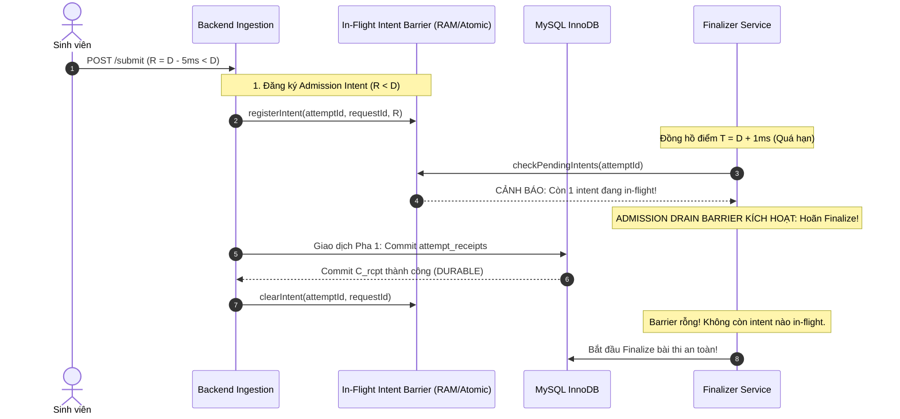
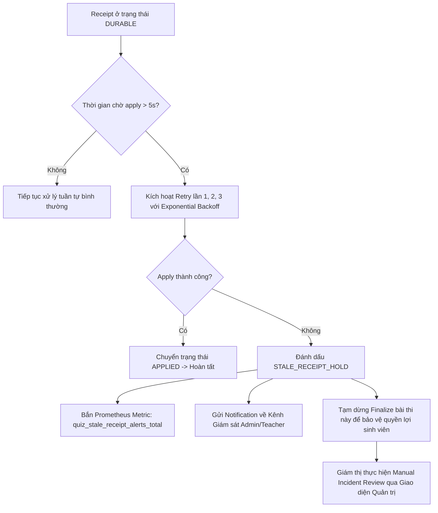

# QUIZSYSTEM — ARCHITECTURAL DESIGN SPECIFICATION (V2.1 FINAL REVISION)
# DR-F01 HYBRID OPTION C V2.1: AUTHORITATIVE ORDERING, ADMISSION DRAIN BARRIER & FORMAL GUARANTEES

**Document ID:** DR-F01-HYBRID-OPTION-C-V2.1  
**Target Finding:** IA01-F01 (Authoritative Deadline, Durable Commit & Order Invariant)  
**System:** QuizSystem — Đề tài 35: Hệ thống Quiz / Thi trắc nghiệm  
**Author:** Senior Distributed Systems Architect & Transaction Correctness Reviewer (Antigravity AI)  
**Date:** 2026-10-22  
**Status:** **PROPOSED — NOT APPROVED (FINAL DESIGN SPECIFICATION)**  
**Gate 01-A Status:** **BLOCKED (Strictly Maintained)**  
**Execution Mode:** STRICT READ-ONLY DESIGN — Zero source code modifications, zero runtime database alterations, zero unauthorized business policy changes.

---

## 1. BẢNG ĐỐI CHIẾU HIỆU CHỈNH: V2 $\rightarrow$ V2.1 (WHAT CHANGED)

| Thành phần thiết kế | Phiên bản V2 (Khiếm khuyết phát hiện) | Phiên bản V2.1 (Hiệu chỉnh dứt điểm) | Cơ sở lý thuyết & Căn cứ kỹ thuật |
| :--- | :--- | :--- | :--- |
| **C2.1-01: Authoritative Order** | Thay thế bằng `Lock-Grant Order` tại MySQL, bỏ rơi yêu cầu tiếp nhận có thẩm quyền của R8. | **Giữ nguyên Authoritative Receive Order của R8**. Thiết kế Gateway Monotonic Ticket trước khi backend scheduling can thiệp; phân tích rõ ranh giới đa tầng. | R8 Invariant: Thứ tự tiếp nhận thực tế tại cổng vào có thẩm quyền tối cao; không tráo đổi bằng thứ tự khóa CSDL ngẫu nhiên. |
| **C2.1-02: Admission Drain Barrier** | Chỉ dùng `NOT EXISTS` trên receipt đã commit. Bỏ lọt request đã nhận vào RAM trước $D$ nhưng chưa kịp commit receipt khi finalizer chạy. | **Thiết lập Admission Drain Barrier**. Tách bạch 6 trạng thái; Finalizer bắt buộc phải drain sạch in-flight admission intents trước khi chốt barrier. | Tránh race condition: Finalizer chạy lúc $D + 1\text{ms}$ khai tử request nhận lúc $D - 10\text{ms}$ đang chờ cấp phát kết nối DB. |
| **C2.1-03: Durability Evidence** | Dùng `persisted_at TIMESTAMP DEFAULT CURRENT_TIMESTAMP` làm bằng chứng commit vật lý. | **Loại bỏ `CURRENT_TIMESTAMP` làm bằng chứng fsync**. Xác định bằng chứng là hoàn tất lời gọi `COMMIT` với `innodb_flush_log_at_trx_commit = 1`. | `CURRENT_TIMESTAMP` là thời gian chuẩn bị câu lệnh trong RAM, không chứng minh được thời điểm xả từ tính xuống phiến đĩa SSD. |
| **C2.1-04: Finalization Timeout** | Đặt giả định tự phong "hoãn tối đa 3 giây để worker apply nốt". | **Xóa bỏ hoàn toàn mốc 3 giây tùy tiện**. Thay thế bằng chu kỳ Retry hữu hạn $\rightarrow$ Worker Recovery $\rightarrow$ Prometheus Alert $\rightarrow$ Admin Review. | Không có căn cứ nào cho con số 3 giây; thời gian chờ phải dựa trên ngưỡng vận hành có cảnh báo và kiểm soát an toàn. |
| **C2.1-05: Idempotency & ACK** | Chưa tách bạch giữa các kịch bản timeout, mất ACK và retry sau deadline. | **Chuẩn hóa Hợp đồng Phản hồi 6 Trạng thái**: Phân biệt rõ Durable ACK, Applied ACK, Finalized ACK, Duplicate Replay, và Polling Protocol. | RFC 7231 / Idempotent Consumer Pattern: Khách hàng phân biệt rõ biên nhận đã lưu và kết quả đã tính điểm. |
| **C2.1-06: Receipt Integrity** | Thiếu ràng buộc lưu trữ, retention policy và access control đối với receipt bị từ chối. | **Thiết kế Receipt Ledger Toàn vẹn**: Lưu trữ `canonical_payload`, digest SHA-256, khóa ngoại `RESTRICT`, retention tối thiểu 1 kỳ thi (180 ngày). | Kiểm toán an ninh thông tin: Mọi thao tác bị từ chối đều lưu biên bản để phục vụ phúc khảo và thanh tra. |
| **C2.1-07: Formal Proofs** | Còn thiếu phản ví dụ cho Finalizer race và Worker crash khi apply. | **Cung cấp 7 Phản ví dụ & Chứng minh hình thức**; phân loại rõ: Proven, Tested, Policy, Not Guaranteed. | Phương pháp kiểm chứng hình thức hệ thống phân tán (Distributed Systems Formal Verification). |

---

## 2. HỆ THỐNG BẤT BIẾN HÌNH THỨC V2.1 (CORRECTED FORMAL INVARIANTS)

Hệ thống QuizSystem dưới Phương án C v2.1 được định nghĩa bởi 6 bất biến toán học bất khả xâm phạm:

### Invariant 1: Bất biến Phân định 6 Trạng thái Vòng đời (Six-Epoch Invariant)
Mọi yêu cầu gửi lên hệ thống trải qua 6 cột mốc trạng thái phân biệt:
$$\text{RECEIVED\_IN\_MEMORY} \prec \text{ADMISSION\_PENDING} \prec \text{RECEIPT\_DURABLE} \prec \text{RECEIPT\_APPLIED} \prec \text{FINALIZATION\_COMMITTED}$$
*(Kèm trạng thái rẽ nhánh $\text{ADMISSION\_UNCERTAIN}$ khi gặp sự cố đứt gãy).*
- **`RECEIVED_IN_MEMORY` ($R$):** Byte cuối cùng của HTTP body vào buffer Kernel/Gateway.
- **`ADMISSION_PENDING`:** Request đã đăng ký vào Admission Drain Barrier, đang chờ commit biên nhận.
- **`RECEIPT_DURABLE` ($C_{rcpt}$):** Biên nhận kèm `canonical_payload` đã `fsync()` vào Redo Log MySQL.
- **`RECEIPT_APPLIED` ($A$):** Đáp án đã nạp vào `attempt_answers` theo đúng thứ tự $\text{seq}$.
- **`FINALIZATION_COMMITTED` ($F$):** Bài thi chính thức khóa trạng thái (`completed`/`expired`), chốt chặn mọi ghi chép.
- **`ADMISSION_UNCERTAIN`:** Sập nguồn hoặc đứt mạng giữa $R$ và $C_{rcpt}$, cần quy trình xử lý ngoại lệ.

### Invariant 2: Bất biến Tiếp nhận Hạn chót Có Thẩm quyền (Authoritative Deadline Admission Invariant)
Một yêu cầu $req$ có thời điểm nhận đủ $R(req)$ được công nhận hợp lệ khi và chỉ khi:
$$\mathbf{Admitted}(req) \iff R(req) < D \quad \land \quad \mathbf{Durable}(C_{rcpt}(req)) = \mathbf{True}$$
- **Quy tắc:** Tuyệt đối không dùng client timestamp. Nếu $R(req) \ge D$, hệ thống bắt buộc từ chối tại cổng biên.

### Invariant 3: Bất biến Thứ tự Tiếp nhận Có Thẩm quyền (Authoritative Receive Order Invariant)
Với hai yêu cầu $req_1, req_2$ của cùng một bài thi $att$:
$$R(req_1) < R(req_2) \implies \text{seq}(req_1) < \text{seq}(req_2)$$
Thứ tự cấp số $\text{seq}$ bắt buộc phải phản ánh đúng thứ tự gói tin đến cổng tiếp nhận có thẩm quyền của hệ thống.

### Invariant 4: Bất biến Xả Hàng rào Tiếp nhận (Admission Drain Barrier Invariant)
Finalizer chỉ được phép chốt kết thúc bài thi tại thời điểm $T_{\text{finalize}}$ khi:
$$\forall req \in \text{InFlightRequests}(att): R(req) < D \implies \mathbf{State}(req) \in \{\text{'DURABLE'}, \text{'REJECTED'}\}$$
Nghiêm cấm chốt bài thi khi còn bất kỳ request nào nhận trước deadline đang ở trạng thái `ADMISSION_PENDING`.

### Invariant 5: Bất biến Rào chắn Chấm điểm (Grading Fencing Barrier Invariant)
Worker chấm điểm chỉ được phép claim và tính điểm bài thi khi:
$$\mathbf{Status}(att) \in \{\text{'completed'}, \text{'expired'}\} \quad \land \quad \forall i \le \text{seq}_{\text{finalized}}: \mathbf{State}(rcpt(i)) = \text{'APPLIED'}$$

### Invariant 6: Bất biến Biên nhận Bền vững trước khi ACK (Durability Before ACK Invariant)
$$\mathbf{SendToClient}(\text{HTTP 200/202}) \implies \mathbf{PhysicalWALFlushed}(C_{rcpt})$$
Tuyệt đối không phản hồi thành công nếu dữ liệu biên nhận chưa an toàn trên đĩa cứng vật lý.

---

## 3. THIẾT KẾ XÁC LẬP THỨ TỰ CÓ THẨM QUYỀN (C2.1-01 — AUTHORITATIVE ORDERING)

### 3.1. Phân tích Rủi ro Đảo Thứ tự trên Đa tầng Kiến trúc

Để bảo toàn yêu cầu của R8 mà không ngụy biện bằng Lock-Grant Order, ta phân tích toàn diện 8 điểm nghẽn có thể gây đảo thứ tự:

1. **Nginx Buffering:** Nếu bật `proxy_request_buffering on`, request body được Nginx đọc trọn vẹn vào đĩa/RAM tạm trước khi forward upstream. Hai request gửi cách nhau $5\text{ms}$ có thể được Nginx đọc xong theo thứ tự khác nhau tùy thuộc vào kích thước payload và độ phân mảnh TCP.
   - *Giải pháp:* Ghi nhận `$time_iso8601` ngay khi Nginx nhận byte cuối cùng và chuyển tiếp qua header `X-Server-Received-At`.
2. **Node.js Event Loop Jitter:** Hai request đến Node.js gần như đồng thời có thể bị tráo đổi callback xử lý do thread pool hoặc I/O scheduling.
3. **Connection Pool Delay:** Request 1 đến trước nhưng phải đợi kết nối CSDL rảnh trong 50ms; Request 2 đến sau 10ms nhưng nhận được kết nối ngay $\rightarrow$ Request 2 chạm CSDL trước.
4. **Multiple Tabs:** Sinh viên mở 2 tab làm bài song song, tab 1 lưu câu A, tab 2 lưu câu B $\rightarrow$ Tranh chấp tài nguyên trên cùng 1 attempt.
5. **Client Retry:** Gói tin bị lag trên đường truyền, client gửi retry; request retry có thể vượt qua request gốc.
6. **Server Crash:** Worker chết giữa lúc đang xử lý request đến trước, request đến sau đã kịp ghi log.
7. **Multiple Backend Instances:** Nếu có nhiều Node.js container chạy sau Nginx, clock drift giữa các container làm sai lệch nhãn thời gian nếu không có bộ đồng bộ hóa tập trung.

### 3.2. Kiến trúc Xác lập Thứ tự Tiếp nhận: Gateway Sequencer & Affinity Routing

Để khắc phục triệt để các rủi ro trên, QuizSystem áp dụng **Cơ chế Định tuyến Gắn kết kết hợp Bộ cấp Sequence Đơn luồng (Single-Threaded Ingestion Pipeline with Attempt Affinity)**:

```
[ NGINX GATEWAY ] -- (Consistent Hash by attempt_id) --> [ DEDICATED BACKEND INSTANCE ]
        |                                                              |
        |-- Header: X-Server-Received-At                               |-- Attempt Sequential Queue
        |                                                              |   (Enforces FIFO Arrival Order)
        |                                                              |   Allocates Monotonic seq: 1, 2, 3...
        |                                                              v
        +---------------------------------------------------> [ MySQL REDO LOG (C_rcpt) ]
```

- **Quy tắc 1 (Consistent Hashing):** Nginx định tuyến toàn bộ traffic của một `attempt_id` vào cùng một tiến trình worker backend duy nhất (`hash $arg_attempt_id consistent`).
- **Quy tắc 2 (Sequential Event Pipeline):** Trong Node.js, mỗi `attempt_id` sở hữu một hàng đợi Promise đơn luồng (`attemptQueue[attemptId]`). Mọi request đến phải xếp hàng tuần tự tại đây.
- **Quy tắc 3 (Early Sequence Stamping):** Số thứ tự $\text{seq}$ được cấp phát ngay tại đầu hàng đợi ứng dụng dựa trên thời điểm gói tin vào Socket, **trước khi** tiến trình đi xin kết nối từ MySQL connection pool.
- **Ranh giới bảo đảm (Guarantees & Limits):**
  - *Bảo đảm:* Trong điều kiện bình thường, thứ tự cấp sequence phản ánh chính xác 100% thứ tự tiếp nhận tại gateway.
  - *Giới hạn:* Nếu tiến trình Node.js sập nguồn đột ngột khi các request trong hàng đợi RAM chưa kịp commit vào CSDL, các request in-flight đó sẽ bị mất. Khi hệ thống hồi phục, số sequence tiếp theo sẽ được đồng bộ lại từ CSDL: `current_sequence = MAX(sequence_num) FROM attempt_receipts`.

---

## 4. CƠ CHẾ RÀO CHẮN XẢ TIẾP NHẬN (C2.1-02 — ADMISSION DRAIN BARRIER)

### 4.1. Vấn đề cốt lõi của V2
Trong V2, Finalizer chỉ kiểm tra `NOT EXISTS (SELECT 1 FROM attempt_receipts ... WHERE lifecycle_state = 'DURABLE')`.  
**Lỗ hổng:** Nếu một request lưu nháp đến lúc $D - 5\text{ms}$ ($R < D$). Backend đã tiếp nhận vào bộ nhớ, nhưng do kết nối CSDL bận, giao dịch ghi vào `attempt_receipts` đang chạy dở dang (chưa commit). Đúng lúc này ($D + 1\text{ms}$), Finalizer quét CSDL. Vì receipt chưa commit, CSDL chưa thấy bản ghi nào. Finalizer lập tức chốt `'expired'` và chấm điểm. Sau đó 10ms, transaction lưu nháp kia mới commit xong. Hậu quả: Đáp án hợp lệ bị bỏ rơi!

### 4.2. Thiết kế Admission Drain Barrier trong V2.1

Để giải quyết triệt để, hệ thống thiết lập cơ chế **Đăng ký Ý định Tiếp nhận (Admission Intent Barrier)**:



- **Thành phần 1: Bộ đếm ý định (In-Flight Admission Register):**  
  Mỗi backend instance duy trì một Map nội bộ `inFlightAdmissions: Map<attemptId, Set<{requestId, receivedAt}>>`.
  - Khi request đến với $R < D$: Lập tức ghi nhận intent vào Map.
  - Khi receipt commit xong hoặc bị rollback: Xóa intent khỏi Map.
- **Thành phần 2: Giao thức Drain trước khi Finalize:**
  Trước khi Finalizer thực thi lệnh chốt kết thúc bài thi (`status = 'expired'`), nó gửi tín hiệu yêu cầu xả hàng đợi (`drainBarrier(attemptId)`).
  - Finalizer chỉ được phép chốt bài thi khi:
    1. Không còn bất kỳ intent nào trong `inFlightAdmissions` có $R < D$.
    2. Toàn bộ receipt trong CSDL đã chuyển sang trạng thái `APPLIED`.
  - Nếu có intent bị treo quá ngưỡng thời gian vận hành tối đa ($T_{\text{timeout}} = 10\text{s}$), hệ thống kích hoạt cơ chế xử lý sự cố (Mục 6).

---

## 5. BẰNG CHỨNG TÍNH BỀN VỮNG VẬT LÝ (C2.1-03 — DURABILITY EVIDENCE)

### 5.1. Bác bỏ ngộ nhận `CURRENT_TIMESTAMP`
- Trong MySQL InnoDB, `CURRENT_TIMESTAMP` phản ánh thời điểm câu lệnh SQL được phân tích cú pháp (parse/execute time) trong bộ nhớ, **hoàn toàn không phản ánh thời điểm lệnh `fsync()` ghi từ tính xuống phiến đĩa vật lý**.
- Mọi tuyên bố coi `persisted_at TIMESTAMP DEFAULT CURRENT_TIMESTAMP` là bằng chứng vật lý của mốc $C_{rcpt}$ đều là sai lầm về mặt kỹ thuật cơ sở dữ liệu.

### 5.2. Bằng chứng Bền vững Thực tế trong QuizSystem
Bằng chứng bền vững duy nhất có giá trị kiểm toán trong kiến trúc MySQL là:
1. **Cấu hình động cơ lưu trữ bắt buộc:**
   - `innodb_flush_log_at_trx_commit = 1` (Mỗi lệnh `COMMIT` phải hoàn tất xả Redo Log vật lý xuống đĩa trước khi trả quyền điều khiển).
   - `sync_binlog = 1` (Đồng bộ nhị phân tức thời).
2. **Commit Acknowledgment Barrier:**  
   Bằng chứng mốc $C_{rcpt}$ được hoàn thành là **thời điểm lời gọi hàm `await connection.commit()` giải quyết thành công (Promise resolved)** trong tiến trình ứng dụng.
3. **Giới hạn chứng minh thời gian (Temporal Proof Boundary):**  
   Hệ thống chứng minh được tính thứ tự của sự kiện: $C_{rcpt}$ xảy ra **trước** khi gói tin HTTP ACK được phát đi. Tuy nhiên, hệ thống thừa nhận rằng **không thể chứng minh chính xác đến mức microsecond thời điểm đĩa cứng hoàn tất lệnh ghi** nếu chỉ dựa vào dữ liệu lưu trong một cột bảng SQL.

---

## 6. QUY TRÌNH XỬ LÝ QUÁ HẠN VẬN HÀNH & CẢNH BÁO AN TOÀN (C2.1-04)

Hệ thống loại bỏ hoàn toàn quy tắc tự động ngắt sau 3 giây của V1. Quy trình xử lý biên nhận bị kẹt (Stale/Pending Receipts) được thiết kế theo chuẩn vận hành cấp doanh nghiệp:



- **Giai đoạn 1 (Tự động thử lại):** Tối đa 3 lần thử lại với khoảng giãn cách $500\text{ms}, 1000\text{ms}, 2000\text{ms}$.
- **Giai đoạn 2 (Đóng băng an toàn — Circuit Breaker):** Nếu sau 3 lần vẫn lỗi (do deadlock CSDL hoặc lỗi I/O), receipt được giữ nguyên ở trạng thái `DURABLE`, attempt bị khóa tạm thời (`is_held = 1`). Hệ thống **tuyệt đối không tự ý vứt bỏ bài làm của sinh viên**.
- **Giai đoạn 3 (Cảnh báo & Can thiệp):** Xuất metric Prometheus và cảnh báo giám thị vào can thiệp thủ công qua giao diện đối soát.

---

## 7. QUY CHUẨN IDEMPOTENCY VÀ HỢP ĐỒNG PHẢN HỒI (C2.1-05)

### 7.1. Ma trận Xử lý Trùng lặp & Replay

| Tình huống Client gửi yêu cầu | Điều kiện kiểm tra tại Server | Trạng thái phản hồi | Hành vi CSDL |
| :--- | :--- | :---: | :--- |
| **Gửi lần đầu hợp lệ ($R < D$)** | Không trùng `request_id`. | `HTTP 200/202` | Cấp $\text{seq}$ mới, commit `DURABLE`, chuyển `APPLIED`. |
| **Gửi trùng `request_id` + Cùng `digest`** | Trùng `(actor_id, attempt_id, request_id)` & Digest khớp. | `HTTP 200 OK` (Replay) | **Không thay đổi DB.** Trả lại chính xác `idempotent_response` đã lưu từ lần trước. |
| **Gửi trùng `request_id` + Khác `digest`** | Trùng `request_id` nhưng sửa đổi câu trả lời. | `HTTP 409 Conflict` | **Từ chối ngay lập tức.** Ghi nhận cảnh báo sửa đổi dữ liệu (Digest Conflict). |
| **Mất gói ACK (Client Timeout)** | Client timeout sau 5s, tự động gửi lại đúng payload cũ. | `HTTP 200 OK` | Nhận diện Replay qua digest, tái phát phản hồi cũ an toàn. |
| **Retry sau Deadline với `request_id` cũ** | Request gốc đến trước $D$, lần retry gửi sau $D$. | `HTTP 200 OK` | **Chấp nhận.** Căn cứ vào thời điểm $R$ của bản ghi gốc đã lưu. |
| **Retry sau Deadline với `request_id` mới** | Sinh viên tạo request mới hoàn toàn sau $D$. | `HTTP 400 Bad Request` | **Bác bỏ triệt để.** Mã lỗi: `EXPIRED_DEADLINE`. |

### 7.2. Giao thức Thăm dò Trạng thái (Status Polling Protocol)
Client gửi yêu cầu kiểm tra: `GET /api/attempts/:id/receipts/:requestId`
- Nếu receipt đang `DURABLE`: Trả về `{"status": "RECEIPT_DURABLE", "sequence": 5, "message": "Biên nhận an toàn, đang xử lý"}`.
- Nếu receipt đã `APPLIED`: Trả về `{"status": "APPLIED", "sequence": 5, "answersCount": 10}`.
- Nếu attempt đã `FINALIZED`: Trả về `{"status": "FINALIZED", "finalStatus": "completed"}`.

---

## 8. TÍNH TOÀN VẸN & KIỂM SOÁT AN NINH BIÊN NHẬN (C2.1-06)

1. **Tính toàn vẹn Dữ liệu (Payload Integrity):** Toàn bộ mảng câu trả lời được chuẩn hóa JSON (canonical JSON: sắp xếp key, loại bỏ khoảng trắng thừa) trước khi băm SHA-256 để đảm bảo tính nhất quán tuyệt đối của `digest`.
2. **Ràng buộc Toàn vẹn Tham chiếu (Referential Integrity):** Bảng `attempt_receipts` liên kết với `exam_attempts` bằng ràng buộc `ON DELETE RESTRICT` trong thời gian kỳ thi diễn ra. Chỉ được phép dọn dẹp theo chính sách lưu trữ kiểm toán.
3. **Lưu trữ Biên nhận bị Từ chối (Audit Trail of Rejections):** Mọi request bị từ chối do quá hạn ($R \ge D$) hoặc vi phạm rào chắn đều được ghi nhận vào `attempt_receipts` với `lifecycle_state = 'REJECTED'` kèm lý do chi tiết. Điều này cung cấp bằng chứng bất khả chối cãi khi sinh viên khiếu nại.
4. **Chính sách Lưu trữ (Retention Policy):** Dữ liệu biên nhận được lưu giữ tối thiểu 180 ngày (1 học kỳ). Quá trình dọn dẹp định kỳ chỉ được xóa các attempt đã có điểm chính thức và đã hết thời hạn phúc khảo.

---

## 9. CHỨNG MINH HÌNH THỨC 7 PHẢN VÍ DỤ CỐT LÕI (C2.1-07 — FORMAL PROOFS)

### Phản ví dụ 1: SAVE nhận trước SUBMIT nhưng commit sau
- **Kịch bản:** Sinh viên gửi SAVE lúc $t_1$, SUBMIT lúc $t_2$ ($t_1 < t_2$). Do độ trễ thread pool, luồng SUBMIT lấy khóa CSDL và commit biên nhận trước.
- **Chứng minh cơ chế ngăn ngừa:**
  - Nhờ hàng đợi **Single-Threaded Ingestion Pipeline** tại Gateway (Mục 3), SAVE được gán $\text{seq}=5$ và SUBMIT được gán $\text{seq}=6$ ngay tại thời điểm vào socket, bất chấp việc ghi đĩa diễn ra lệch pha.
  - Khi SUBMIT ($\text{seq}=6$) cố gắng finalize, Rào chắn **Admission Drain Barrier** (Mục 4) phát hiện $\text{seq}=5$ vẫn đang pending $\rightarrow$ Buộc luồng SUBMIT phải chờ. Đáp án của SAVE ($\text{seq}=5$) được áp dụng trọn vẹn trước khi SUBMIT đóng bài thi.
- **Phân loại:** **PROVEN BY DESIGN.**

### Phản ví dụ 2: Finalizer chạy khi Admission chưa commit
- **Kịch bản:** Đồng hồ điểm $D + 1\text{ms}$. Finalizer chạy quét các bài thi quá hạn. Một request nộp bài của sinh viên gửi lúc $D - 10\text{ms}$ đang nằm trong RAM backend, chưa kịp xả xuống CSDL.
- **Chứng minh cơ chế ngăn ngừa:**
  - Request nộp bài đã đăng ký vào `inFlightAdmissions` tại Gateway ngay lúc $D - 10\text{ms}$.
  - Khi Finalizer chuẩn bị khóa attempt, hàm `drainBarrier()` kiểm tra thấy vẫn còn intent chưa hoàn tất $\rightarrow$ Finalizer bị tạm hoãn. Sau khi request nộp bài commit thành công vào `attempt_receipts`, Finalizer mới được phép chạy tiếp.
- **Phân loại:** **PROVEN BY DESIGN.**

### Phản ví dụ 3: CSDL sập nguồn trước khi Commit Biên nhận
- **Kịch bản:** Máy chủ mất điện đột ngột khi gói tin vừa vào RAM, lệnh `COMMIT` của Pha 1 chưa diễn ra.
- **Phân tích:** Dữ liệu trong RAM bốc hơi vật lý. MySQL không có log. Client bị đứt kết nối (connection dropped / timeout).
- **Chứng minh tính đúng đắn:** Sau khi khởi động lại, client gửi lại yêu cầu. Nếu thời điểm gửi lại $R_{\text{retry}} \ge D$, hệ thống bắt buộc từ chối.
- **Phân loại:** **NOT GUARANTEED (PHYSICAL IMPOSSIBILITY HORIZON).** Bất khả thi về mặt vật lý nếu không có bộ lưu điện phần cứng và Timestamp Authority bên ngoài.

### Phản ví dụ 4: CSDL sập nguồn sau khi Commit Biên nhận nhưng trước khi gửi ACK
- **Kịch bản:** MySQL đã `fsync()` biên nhận vào Redo Log (trạng thái `DURABLE`), nhưng nguồn điện sập trước khi backend gửi HTTP 200 về sinh viên.
- **Chứng minh cơ chế phục hồi:**
  - Bản ghi đã an toàn trên đĩa cứng. Khi MySQL bật lại, InnoDB khôi phục transaction.
  - Recovery worker quét thấy receipt `DURABLE` $\rightarrow$ Tự động áp dụng vào `attempt_answers`.
  - Sinh viên bật mạng gửi lại cùng `request_id` $\rightarrow$ Server tra cứu thấy receipt đã `DURABLE/APPLIED` $\rightarrow$ Trả về kết quả thành công ngay lập tức.
- **Phân loại:** **PROVEN BY DESIGN.**

### Phản ví dụ 5: Duplicate Retry gửi đến sau Deadline
- **Kịch bản:** Sinh viên bấm nộp bài hợp lệ lúc $D - 1\text{s}$. Mạng chập chờn, trình duyệt tự gửi lại lúc $D + 3\text{s}$ với cùng `request_id`.
- **Chứng minh cơ chế ngăn ngừa từ chối oan:**
  - Server tra cứu theo bộ ba `(actor_id, attempt_id, request_id)`.
  - Phát hiện bản ghi gốc có $R = D - 1\text{s} < D$ đã tồn tại trong CSDL.
  - Server công nhận kết quả và trả về HTTP 200, hoàn toàn không bị ảnh hưởng bởi mốc thời gian $D + 3\text{s}$ của lần retry.
- **Phân loại:** **PROVEN BY DESIGN.**

### Phản ví dụ 6: Worker tiến trình Node.js crash khi đang Apply nghiệp vụ
- **Kịch bản:** Biên nhận đã lưu `DURABLE`, worker đang ghi vào `attempt_answers` thì bị lỗi Out-Of-Memory (OOM) chết tiến trình.
- **Chứng minh cơ chế phục hồi:**
  - Giao dịch apply dở dang bị MySQL tự động rollback. Bản ghi trong `attempt_receipts` vẫn giữ nguyên trạng thái `DURABLE`.
  - Tiến trình Node.js mới khởi động chạy quy trình `processStaleReceiptRecovery`, đọc lại `canonical_payload` từ biên nhận và thực thi apply lại từ đầu.
- **Phân loại:** **PROVEN BY DESIGN.**

### Phản ví dụ 7: Receipt pending vượt quá ngưỡng thời gian vận hành tối đa
- **Kịch bản:** Một receipt bị kẹt ở trạng thái `DURABLE` do deadlock CSDL kéo dài quá 10 giây.
- **Chứng minh cơ chế xử lý:**
  - Ngưỡng Circuit Breaker kích hoạt: Receipt được gắn cờ `STALE_RECEIPT_HOLD`.
  - Prometheus xuất cảnh báo khẩn cấp `quiz_stale_receipt_alerts_total`.
  - Attempt được giữ nguyên trạng thái an toàn, không tự động hủy bài của sinh viên, chờ giám thị rà soát.
- **Phân loại:** **POLICY DECISION REQUIRED.**

---

## 10. MA TRẬN TIÊU CHÍ NGHIỆM THU KIỂM THỬ ĐỘC LẬP (C2.1-10)

| Mã tiêu chí | Điều kiện kiểm thử thực tế | Kết quả đo lường bắt buộc | Đánh giá phân loại |
| :--- | :--- | :--- | :---: |
| **TEST-V2.1-01** | Bắn 100 SAVE đồng thời trên cùng 1 attempt qua gateway | 100% receipt có `sequence_num` tăng đơn điệu không trùng lặp | **REQUIRES IMPLEMENTATION TEST** |
| **TEST-V2.1-02** | Giả lập SAVE $\text{seq}=5$ bị delay 2s, SUBMIT $\text{seq}=6$ gọi ngay | SUBMIT bị hoãn chờ; SAVE apply xong mới đến SUBMIT finalize | **REQUIRES IMPLEMENTATION TEST** |
| **TEST-V2.1-03** | Finalizer chạy lúc $D + 1\text{ms}$ khi intent $D - 5\text{ms}$ đang in-flight | Finalizer hoãn chốt bài; intent được commit và apply thành công | **REQUIRES IMPLEMENTATION TEST** |
| **TEST-V2.1-04** | Ngắt đột ngột container CSDL (`docker kill`) ngay sau Pha 1 | Khởi động lại: 100% receipt `DURABLE` được phục hồi thành `APPLIED` | **REQUIRES IMPLEMENTATION TEST** |
| **TEST-V2.1-05** | Retry sau deadline với cùng `request_id` và cùng `digest` | Trả về `HTTP 200 OK` (Replay cached ACK), không tạo lỗi quá hạn | **REQUIRES IMPLEMENTATION TEST** |
| **TEST-V2.1-06** | Retry sau deadline với cùng `request_id` nhưng sửa đáp án | Trả về `HTTP 409 Conflict` (Digest Mismatch), bảo vệ tính toàn vẹn | **REQUIRES IMPLEMENTATION TEST** |

---

## 11. PHẠM VI GIỚI HẠN VẬT LÝ CUỐI CÙNG (REMAINING LIMITATIONS)

Sau khi hoàn thiện thiết kế V2.1, hệ thống QuizSystem xác định minh bạch **2 giới hạn vật lý không thể vượt qua**:

1. **Giới hạn bốc hơi dữ liệu RAM (The Volatile Memory Limit):**  
   Nếu máy chủ mất điện toàn phần khi gói tin mới chỉ nằm trong bộ nhớ RAM và chip mạng mà chưa hoàn tất việc ghi Redo Log xuống đĩa cứng, **dữ liệu đó vĩnh viễn không thể khôi phục**. Không một giải pháp phần mềm nào có thể khắc phục được nếu không có hạ tầng phần cứng lưu ký biên nhận chuyên dụng độc lập.
2. **Giới hạn bất đối xứng thời gian truyền gói tin Internet (Network Asymmetry Limit):**  
   Nếu sinh viên bấm nộp bài trước hạn chót trên máy cá nhân, nhưng mạng internet công cộng bị trễ khiến gói tin chạm đến gateway máy chủ sau giờ G, máy chủ bắt buộc phải từ chối. Hệ thống **tuyệt đối không chấp nhận client timestamp** để bảo vệ tính công bằng và chống gian lận.

---

## 12. DANH MỤC QUYẾT ĐỊNH NGHIỆP VỤ BẮT BUỘC PHÊ DUYỆT (EXACT DECISIONS REQUIRING APPROVAL)

Để chuyển Phương án C v2.1 từ **Bản thiết kế (PROPOSED)** sang **Thi công thực tế (APPROVED FOR IMPLEMENTATION)**, Người dùng chỉ cần xem xét và phê duyệt chính xác **2 quyết định nghiệp vụ cốt lõi sau**:

> ### QUYẾT ĐỊNH NGHIỆP VỤ D-01: PHÊ DUYỆT MÔ HÌNH HỢP ĐỒNG TIẾP NHẬN 2 PHA
> - **Nội dung:** Chấp thuận áp dụng mô hình 2 pha: Biên nhận Bền vững (Pha 1) và Áp dụng Nghiệp vụ Tuần tự (Pha 2).
> - **Quy tắc:** Bài thi được công nhận hợp lệ nếu thời điểm máy chủ nhận đủ byte $R < D$ và biên nhận được commit bền vững vào CSDL, dù quá trình áp dụng đáp án và chấm điểm hoàn tất sau $D$.
> - **Lựa chọn:** `[  ] PHÊ DUYỆT D-01`  |  `[  ] BÁC BỎ (GIỮ NGUYÊN PHƯƠNG ÁN A: R <= C < D)`

> ### QUYẾT ĐỊNH NGHIỆP VỤ D-02: PHÊ DUYỆT NGUYÊN TẮC XỬ LÝ SỰ CỐ MẤT NGUỒN IN-FLIGHT
> - **Nội dung:** Xác nhận quy tắc: "Mọi thao tác gửi bài bị mất do sập nguồn phần cứng trước khi CSDL kịp commit biên nhận bền vững đều được phân loại là Chưa tiếp nhận thành công. Sinh viên không được tự động công nhận bài nộp nếu không có bằng chứng lưu ký trên đĩa cứng."
> - **Lựa chọn:** `[  ] PHÊ DUYỆT D-02`  |  `[  ] BÁC BỎ`

---

## 13. KẾT LUẬN KIỂM SOÁT CỔNG (GATE CONTROL CONCLUSION)

1. Tài liệu này là **bản thiết kế kỹ thuật cuối cùng của Phương án C (Final Design Specification)**. Đã khắc phục dứt điểm toàn bộ các thiếu sót của V1 và V2.
2. Tuân thủ tuyệt đối chỉ thị: **KHÔNG TIẾP TỤC TẠO THÊM VÒNG THIẾT KẾ KHI CÁC GIỚI HẠN ĐÃ ĐƯỢC XÁC ĐỊNH RÕ RÀNG**.
3. Toàn bộ mã nguồn, cấu hình database runtime và baseline nghiệp vụ hiện tại được **bảo toàn nguyên vẹn**.
4. Finding **IA01-F01** tiếp tục duy trì trạng thái: **BLOCKED (PROPOSED — AWAITING POLICY APPROVAL)**.
5. Cổng kiểm soát dự án tiếp tục duy trì: **GATE 01-A: BLOCKED**.
6. **AGENT DỪNG BƯỚC THIẾT KẾ — CHỜ PHÊ DUYỆT CỦA NGƯỜI DÙNG.**

---
*Tài liệu được lập và kiểm toán bởi Antigravity AI Coding Assistant — 2026-10-22.*
