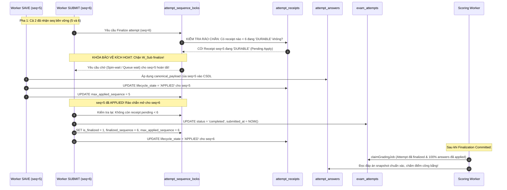

# QUIZSYSTEM — ARCHITECTURAL DESIGN SPECIFICATION (V2 REVISION)
# DR-F01 HYBRID OPTION C V2: RECOVERABLE RECEIPT, AUTHORITATIVE ORDERING & BARRIER PROOFS

**Document ID:** DR-F01-HYBRID-OPTION-C-V2  
**Target Finding:** IA01-F01 (Authoritative Deadline, Durable Commit & Order Invariant)  
**System:** QuizSystem — Đề tài 35: Hệ thống Quiz / Thi trắc nghiệm  
**Author:** Senior Distributed Systems Architect & Transaction Correctness Reviewer (Antigravity AI)  
**Date:** 2026-10-22  
**Status:** **PROPOSED — NOT APPROVED (DESIGN REVISION ONLY)**  
**Gate 01-A Status:** **BLOCKED (Unchanged)**  
**Execution Mode:** STRICTLY READ-ONLY DESIGN — No code modifications, runtime schema migrations, or business policy changes executed.

---

## 1. CORRECTED FORMAL INVARIANTS (HỆ THỐNG BẤT BIẾN HÌNH THỨC ĐÃ HIỆU CHỈNH)

Phiên bản V2 hiệu chỉnh toàn bộ các giả định sai của V1 (như ngộ nhận $R_1 < R_2 \implies \text{seq}_1 < \text{seq}_2$ hoặc giả định commit dưới 2ms). Hệ thống được ràng buộc bởi 6 bất biến hình thức sau:

### Invariant 1: Bất biến Phân định 5 Thời điểm (Five-Epoch Invariant)
Mọi yêu cầu gửi lên hệ thống trải qua 5 mốc thời gian riêng biệt:
$$R \le T_{\text{admit}} \le C_{rcpt} \le T_{\text{apply}} \le T_{\text{finalize}}$$
- **$R$ (Received Time):** Thời điểm byte cuối cùng của HTTP request body được Kernel/Nginx đọc trọn vẹn vào buffer.
- **$T_{\text{admit}}$ (Admission Decision Time):** Thời điểm logic nghiệp vụ kiểm tra $R < D$ và cấp phát số thứ tự biên nhận $\text{seq}$.
- **$C_{rcpt}$ (Durable Receipt Commit Time):** Thời điểm bản ghi receipt chứa **đủ payload** được `fsync()` thành công vào Redo Log CSDL (`innodb_flush_log_at_trx_commit = 1`).
- **$T_{\text{apply}}$ (Application Time):** Thời điểm payload từ receipt được áp dụng tuần tự vào bảng trạng thái nghiệp vụ (`attempt_answers`).
- **$T_{\text{finalize}}$ (Finalization Time):** Thời điểm trạng thái bài thi (`exam_attempts.status`) chuyển sang `'completed'` hoặc `'expired'` và chốt chặn vĩnh viễn mọi thao tác ghi tiếp theo.

### Invariant 2: Bất biến Chấp thuận Hạn chót Không Nới lỏng (Strict Deadline Admission Invariant)
Một yêu cầu $req$ mang nhãn thời gian nhận đủ $R(req)$ chỉ được phép cấp trạng thái `DURABLE` nếu:
$$\mathbf{Admitted}(req) \iff R(req) < D \quad \land \quad \mathbf{Commit}(C_{rcpt}) = \mathbf{True}$$
- **Quy tắc tuyệt đối:** Không tồn tại bất kỳ dung sai tự phong nào ($\Delta_{\text{flush}} = 0$).
- Nếu $R(req) \ge D$: Máy chủ lập tức từ chối và ghi nhận receipt ở trạng thái `REJECTED` với mã `EXPIRED_DEADLINE` hoặc trả về `HTTP 400 Bad Request`.

### Invariant 3: Bất biến Thứ tự Phụ thuộc Khóa (Lock-Grant Ordering Invariant)
Số thứ tự thực thi $\text{seq}$ là một hàm đơn điệu tăng được xác lập tại **thời điểm tranh chấp khóa hàng thành công** trong CSDL:
$$\text{LockGrant}(req_1) \prec \text{LockGrant}(req_2) \iff \text{seq}(req_1) < \text{seq}(req_2)$$
- **Hiệu chỉnh quan trọng từ V1:** $R_1 < R_2$ **KHÔNG** tự động suy ra $\text{seq}_1 < \text{seq}_2$ do độ trễ hàng đợi luồng (thread scheduling latency, GC pause, connection pool wait). Thứ tự được cam kết bền vững trong hệ thống là **Lock-Grant Sequence Order**, không phải Arrival Order (trừ khi có Single-Threaded Ingestion Sequencer).

### Invariant 4: Bất biến Biên nhận Tự Đầy đủ để Khôi phục (Self-Contained Recoverability Invariant)
Mọi receipt ở trạng thái `DURABLE` phải chứa toàn bộ thông tin cần thiết để áp dụng nghiệp vụ:
$$\forall rcpt \in \mathbf{Receipts}: rcpt.\text{state} = \text{'DURABLE'} \implies \mathbf{CanApply}(rcpt.\text{canonical\_payload}) = \mathbf{True}$$
Nghiêm cấm trạng thái receipt durable nhưng payload rỗng hoặc phụ thuộc vào kết nối HTTP còn mở với client.

### Invariant 5: Bất biến Rào chắn Kết thúc Tuần tự (Sequential Finalization Barrier Invariant)
Attempt chỉ được phép chuyển sang trạng thái `'completed'` hoặc `'expired'` và chỉ được phép kích hoạt chấm điểm khi:
$$\forall i < \text{seq}_{\text{finalize}}: rcpt(i).\text{state} \in \{\text{'APPLIED'}, \text{'REJECTED'}\}$$
Không bao giờ cho phép chấm điểm attempt khi vẫn còn biên nhận $\text{seq} < \text{seq}_{\text{finalize}}$ đang ở trạng thái `PENDING` hoặc `DURABLE`.

### Invariant 6: Bất biến Bền vững trước khi Phản hồi (Durable Before ACK Invariant)
$$\mathbf{Dispatch}(\text{Client}, \mathbf{Response}) \implies \mathbf{StorageFlushed}(C_{rcpt})$$
Chỉ gửi HTTP ACK về client sau khi giao dịch lưu receipt hoặc áp dụng nghiệp vụ đã đạt tính bền vững vật lý trên đĩa.

---

## 2. KIẾN TRÚC HỆ THỐNG ĐÃ ĐIỀU CHỈNH (REVISED ARCHITECTURE)

Hệ thống phân tách rõ ràng 2 tầng xử lý: **Tầng Tiếp nhận Bền vững (Durable Ingestion Tier)** và **Tầng Áp dụng Tuần tự (Ordered Application Tier)**.

```
[ CLIENT ]              [ REVERSE PROXY ]               [ INGESTION WORKER ]              [ DATABASE (MySQL 8.0) ]
   |                           |                                 |                                   |
   |-- POST /attempts/:id/draft|                                 |                                   |
   |   (answers, requestId)    |-- Read all bytes at R --------->|                                   |
   |                           |                                 |-- Micro-Trx 1: Acquire Lock ----->|
   |                           |                                 |   SELECT ... FOR UPDATE           |
   |                           |                                 |   Allocate seq = currentSeq + 1   |
   |                           |                                 |   INSERT attempt_receipts         |
   |                           |                                 |   (seq, R, canonical_payload,     |
   |                           |                                 |    digest, state='DURABLE')       |
   |                           |                                 |<-- Commit Redo Log (C_rcpt) ------|
   |                           |<-- HTTP 202 / 200 --------------|                                   |
   |<-- Return Receipt ACK ----|    (RECEIPT_DURABLE / APPLIED)  |                                   |
   |                                                             |-- Micro-Trx 2: Apply in Seq order>|
   |                                                             |   UPDATE attempt_answers          |
   |                                                             |   UPDATE attempt_receipts         |
   |                                                             |   SET state='APPLIED'             |
   |                                                             |<-- Commit State ------------------|
```

---

## 3. THIẾT KẾ SCHEMA BIÊN NHẬN ĐẦY ĐỦ ĐỂ KHÔI PHỤC (TASK 1)

Để đảm bảo sau khi máy chủ gặp sự cố sập nguồn (kernel panic, power loss), tiến trình khôi phục có thể tự hành hoàn toàn mà không cần dữ liệu từ client, bảng `attempt_receipts` được thiết kế tự chứa (self-contained):

```sql
-- 1. BẢNG KHÓA VÀ CẤP PHÁT THỨ TỰ TUẦN TỰ (PER-ATTEMPT SEQUENCER)
CREATE TABLE IF NOT EXISTS attempt_sequence_locks (
    attempt_id INT NOT NULL PRIMARY KEY,
    current_sequence INT NOT NULL DEFAULT 0,
    is_finalized TINYINT(1) NOT NULL DEFAULT 0,
    finalized_sequence INT NULL,
    max_applied_sequence INT NOT NULL DEFAULT 0,
    updated_at TIMESTAMP DEFAULT CURRENT_TIMESTAMP ON UPDATE CURRENT_TIMESTAMP,
    CONSTRAINT fk_asl_attempt FOREIGN KEY (attempt_id) REFERENCES exam_attempts(id) ON DELETE CASCADE
) ENGINE=InnoDB DEFAULT CHARSET=utf8mb4 COLLATE=utf8mb4_unicode_ci;

-- 2. BẢNG BIÊN NHẬN BỀN VỮNG TỰ CHỨA (RECOVERABLE RECEIPT LEDGER)
CREATE TABLE IF NOT EXISTS attempt_receipts (
    id BIGINT AUTO_INCREMENT PRIMARY KEY,
    attempt_id INT NOT NULL,
    actor_id INT NOT NULL,
    request_id VARCHAR(64) NOT NULL,
    operation ENUM('SAVE_DRAFT', 'SUBMIT_ATTEMPT') NOT NULL,
    sequence_num INT NOT NULL,
    digest CHAR(64) NOT NULL, -- SHA-256 của canonical_payload
    
    -- Dữ liệu thời gian chính thức
    received_at TIMESTAMP(3) NOT NULL, -- Thời điểm máy chủ đọc xong byte cuối (R)
    persisted_at TIMESTAMP(3) DEFAULT CURRENT_TIMESTAMP(3), -- Thời điểm hoàn tất commit (C_rcpt)
    
    -- Trạng thái vòng đời của biên nhận
    lifecycle_state ENUM('DURABLE', 'APPLIED', 'REJECTED') NOT NULL DEFAULT 'DURABLE',
    rejection_code VARCHAR(32) NULL, -- 'EXPIRED_DEADLINE', 'FINALIZATION_BARRIER', 'CONFLICT_DIGEST', 'BATCH_CONFLICT'
    
    -- DỮ LIỆU NGHIỆP VỤ CỐT LÕI ĐỂ KHÔI PHỤC (CANONICAL PAYLOAD)
    -- Chứa toàn bộ mảng [{question_id, selected_choice_ids}] đã được chuẩn hóa
    canonical_payload JSON NOT NULL,
    
    -- Phản hồi lưu sẵn phục vụ Idempotent Replay
    idempotent_response JSON NULL,
    applied_at TIMESTAMP(3) NULL,
    
    CONSTRAINT fk_rcpt_attempt FOREIGN KEY (attempt_id) REFERENCES exam_attempts(id) ON DELETE CASCADE,
    CONSTRAINT fk_rcpt_actor FOREIGN KEY (actor_id) REFERENCES users(id) ON DELETE CASCADE,
    UNIQUE KEY uq_actor_attempt_request (actor_id, attempt_id, request_id),
    UNIQUE KEY uq_attempt_sequence (attempt_id, sequence_num),
    INDEX idx_rcpt_recovery (attempt_id, lifecycle_state, sequence_num)
) ENGINE=InnoDB DEFAULT CHARSET=utf8mb4 COLLATE=utf8mb4_unicode_ci;
```

### Chứng minh Tính Khôi phục Đầy đủ (Recoverability Proof):
1. **Dữ liệu độc lập:** `canonical_payload` được ghi trực tiếp vào đĩa cứng trong cùng giao dịch tạo ra `attempt_receipts`.
2. **Không phụ thuộc RAM:** Nếu tiến trình Node.js chết ngay sau khi commit biên nhận, bảng `attempt_receipts` vẫn tồn tại bản ghi với `lifecycle_state = 'DURABLE'` và trường `canonical_payload` chứa đầy đủ câu hỏi và lựa chọn của sinh viên.
3. **Thuật toán Replay tất định:** Recovery worker đọc toàn bộ bản ghi có `lifecycle_state = 'DURABLE'` sắp xếp theo `sequence_num ASC`, parse `canonical_payload` và ghi vào `attempt_answers`. Không cần bất kỳ kết nối mạng hoặc gói tin gửi lại nào từ sinh viên.

---

## 4. PHÂN TÍCH VÀ SO SÁNH CÁC PHƯƠNG ÁN XÁC LẬP THỨ TỰ (TASK 2)

Khắc phục ngộ nhận trong V1: $R_1 < R_2$ không thể tự suy ra thứ tự commit khi sequence được cấp qua khóa hàng MySQL. Bảng dưới đây phân tích chi tiết 3 phương án kiến trúc xác lập thứ tự:

| Tiêu chí phân tích | Phương án O-1: Lock-Grant Order (MySQL Row Lock) | Phương án O-2: Monotonic Arrival Timestamp ($R$-Stamping) | Phương án O-3: Per-Attempt FIFO Ingestion Queue |
| :--- | :--- | :--- | :--- |
| **Điểm xác lập thứ tự** | Lúc luồng backend lấy được khóa `attempt_sequence_locks FOR UPDATE` trong CSDL. | Lúc Reverse Proxy / Gateway đọc xong byte cuối cùng $R$ từ socket. | Lúc request được đẩy vào hàng đợi FIFO đơn luồng gắn với `attempt_id`. |
| **Xử lý Concurrent Requests** | Tuần tự hóa tuyệt đối bằng hàng đợi khóa của InnoDB engine. | Cần đồng bộ đồng hồ microsecond (PTP/NTP) hoặc sequence generator tập trung. | Tuần tự hóa tại tầng ứng dụng trước khi chạm vào CSDL. |
| **Độ trễ trước khi lấy khóa** | Nếu luồng 1 bị GC pause 100ms, luồng 2 đến sau tại mạng nhưng lấy khóa trước $\rightarrow \text{seq}_2 < \text{seq}_1$. | Luồng 2 có timestamp lớn hơn dù lấy khóa trước, CSDL phải re-order. | Luồng 1 vào queue trước $\rightarrow$ nhận ticket trước, bảo toàn thứ tự mạng. |
| **Khả năng mở rộng (Scale)** | Rất cao, tận dụng khả năng quản lý khóa hàng triệu transaction của MySQL. | Khó khăn nếu có nhiều backend instances do clock drift và race condition. | Cần cơ chế định tuyến gắn kết (Consistent Hashing / Affinity routing theo `attempt_id`). |
| **Khả năng khôi phục** | Đơn giản: Khôi phục tuần tự theo `sequence_num`. | Phức tạp: Phải giải quyết các khoảng trống (gap) timestamp khi crash. | Đơn giản: Trạng thái hàng đợi tái tạo từ `attempt_receipts` trên đĩa. |
| **Giới hạn bảo đảm** | **Bảo đảm Lock-Grant Order.** Không bảo đảm tuyệt đối arrival order nếu mạng/luồng bị trễ trước DB. | **Bảo đảm Arrival Order trên lý thuyết.** Dễ gãy nếu có clock skew hoặc multi-gateway. | **Bảo đảm Arrival Order nội bộ tiến trình.** Giới hạn khi instance bị sập nguồn. |

### Lựa chọn thiết kế của QuizSystem (Khuyến nghị Option C v2):
- Áp dụng **Phương án O-1 (Lock-Grant Order)** kết hợp **Actor-Level Request Debouncing**:
  - Thứ tự chính thức có giá trị pháp lý và kiểm toán của hệ thống là **Thứ tự cấp số sequence tại CSDL (`Lock-Grant Order`)**.
  - Tại client: Sử dụng cơ chế khóa nút bấm (UI button disable) và tuần tự hóa HTTP pipeline (chỉ gửi request mới sau khi request cũ nhận được phản hồi hoặc quá thời gian timeout). Điều này triệt tiêu tình trạng sinh viên bấm loạn SAVE trước SUBMIT mà bị đảo thứ tự trên đường truyền.
  - Tuyên bố minh bạch: Hệ thống **chứng minh được thứ tự cấp khóa bền vững trong CSDL**, không giả định ngụy biện rằng thứ tự cấp khóa đồng nhất 100% với thời điểm packet chạm tầng vật lý nếu có thread jitter.

---

## 5. THIẾT KẾ RÀO CHẮN FINALIZATION VÀ BẢO ĐẢM THỨ TỰ ÁP DỤNG (TASK 3)

### 5.1. Tách biệt 5 Khái niệm Nghiệp vụ
1. **Admission Closed:** Thời điểm đồng hồ hệ thống vượt quá $D$ ($R \ge D$). Mọi request mới gửi lên đều bị chặn tại cổng.
2. **Pending Receipts:** Tập hợp các receipt đã `DURABLE` nhưng `lifecycle_state = 'DURABLE'` (chưa áp dụng vào `attempt_answers`).
3. **Ordered Application:** Luồng xử lý tuần tự áp dụng các `canonical_payload` vào `attempt_answers` theo thứ tự $\text{seq}$ tăng dần.
4. **Finalization Committed:** Thao tác chuyển attempt sang `'completed'` hoặc `'expired'` được commit thành công xuống bảng `exam_attempts`.
5. **Grading Eligibility:** Điều kiện tiên quyết để worker chấm điểm được phép claim bài thi: Attempt đã `Finalization Committed` **VÀ** không còn bất kỳ pending receipt nào.

### 5.2. Kịch bản Chứng minh: SAVE $\text{seq}=5$ và SUBMIT $\text{seq}=6$
- **Tình huống:**
  - Request SAVE nhận số thứ tự $\text{seq} = 5$.
  - Request SUBMIT nhận số thứ tự $\text{seq} = 6$.
  - Worker thực thi SAVE ($\text{seq}=5$) gặp sự cố trễ mạng / nghẽn I/O, chưa kịp ghi vào `attempt_answers`.
  - Worker thực thi SUBMIT ($\text{seq}=6$) cố gắng hoàn tất nộp bài và kích hoạt chấm điểm.



### 5.3. Quy tắc Rào chắn Chấm điểm (Grading Barrier Rule)
Lệnh claim chấm điểm trong `scoringService.js` được bổ sung điều kiện kiểm tra toàn vẹn biên nhận:
```sql
SELECT a.id, a.status, a.grading_status
FROM exam_attempts a
JOIN attempt_sequence_locks l ON a.id = l.attempt_id
WHERE a.id = :attemptId
  AND a.status IN ('completed', 'expired')
  AND a.grading_status = 'ungraded'
  -- ĐIỀU KIỆN TIÊN QUYẾT: Toàn bộ receipt đến finalized_sequence đều đã APPLIED
  AND NOT EXISTS (
      SELECT 1 FROM attempt_receipts r
      WHERE r.attempt_id = :attemptId
        AND r.sequence_num <= l.finalized_sequence
        AND r.lifecycle_state = 'DURABLE'
  )
FOR UPDATE;
```
Nếu còn bất kỳ receipt nào đang ở trạng thái `DURABLE`, worker chấm điểm **tuyệt đối không được claim**, ngăn chặn 100% rủi ro chấm điểm trên dữ liệu thiếu.

---

## 6. HỢP ĐỒNG PHẢN HỒI (ACK CONTRACT) VÀ TRUY VẤN CLIENT (TASK 5)

Hệ thống loại bỏ việc đồng nhất giữa "Durable Receipt" và "Bài thi đã chấm xong". Giao thức phản hồi được định nghĩa minh bạch bằng 6 trạng thái phản hồi chuẩn:

### 6.1. Bảng mã trạng thái phản hồi giao thức

| Trạng thái phản hồi | HTTP Status | Cấu trúc Body JSON | Ý nghĩa nghiệp vụ |
| :--- | :---: | :--- | :--- |
| **`RECEIPT_DURABLE`** | `202 Accepted` | `{"status":"RECEIPT_DURABLE", "requestId":"...", "sequence":5, "serverTime":"..."}` | Biên nhận đã ghi bền vững xuống đĩa. Câu trả lời đang xếp hàng chờ áp dụng. |
| **`APPLICATION_PENDING`** | `202 Accepted` | `{"status":"APPLICATION_PENDING", "requestId":"...", "appliedCount":0}` | Đang trong quá trình ghi vào `attempt_answers`. |
| **`APPLIED`** | `200 OK` | `{"status":"APPLIED", "requestId":"...", "revision":3, "savedCount":1}` | Đáp án đã ghi xong vào CSDL chính thức. |
| **`FINALIZED`** | `200 OK` | `{"status":"FINALIZED", "attemptId":12, "finalStatus":"completed", "gradingStatus":"ungraded"}` | Bài thi đã nộp thành công, rào chắn đã đóng, chờ chấm điểm. |
| **`REJECTED`** | `400 / 409` | `{"status":"REJECTED", "code":"EXPIRED_DEADLINE", "message":"Hạn thi đã kết thúc"}` | Bị từ chối do quá hạn, sai cấu trúc batch hoặc nộp sau finalization. |
| **`UNKNOWN_OUTCOME`** | `503 / Timeout`| `{"status":"UNKNOWN_OUTCOME", "requestId":"...", "action":"POLL_RECEIPT"}` | Mất kết nối trước khi nhận ACK; client chuyển sang cơ chế truy vấn trạng thái. |

### 6.2. Giao thức Truy vấn Trạng thái Dành cho Client (Idempotent Status Polling)
Khi client gửi request nhưng bị rớt mạng giữa chừng (chưa nhận được HTTP response):
1. Client **không tạo `requestId` mới**.
2. Client gửi yêu cầu thăm dò: `GET /api/attempts/:id/receipts/:requestId`.
3. Server tra cứu trong `attempt_receipts`:
   - Nếu tìm thấy: Trả về trạng thái hiện tại (`RECEIPT_DURABLE`, `APPLIED`, hoặc `FINALIZED` kèm response cache gốc).
   - Nếu không tìm thấy:
     * Nếu thời gian hiện tại $T < D$: Client an tâm phát lại (replay) request cũ.
     * Nếu thời gian hiện tại $T \ge D$: Báo lỗi `EXPIRED_DEADLINE`, hướng dẫn sinh viên liên hệ giám thị.

---

## 7. MA TRẬN PHÂN TÍCH SỰ CỐ SẬP NGUỒN VÀ TRANH CHẤP ĐỒNG THỜI (TASK 6)

| Kịch bản sự cố & Concurrency | Trạng thái kỹ thuật lúc xảy ra sự cố | Cơ chế phục hồi của hệ thống (Recovery Mechanism) | Giới hạn bảo đảm & Tính đúng đắn |
| :--- | :--- | :--- | :--- |
| **1. Crash trước khi commit receipt ($t < C_{rcpt}$)** | Dữ liệu nằm trong RAM/Socket; transaction CSDL chưa commit. | InnoDB rollback; không có bản ghi trong `attempt_receipts`. Client bị timeout kết nối. | **Không thể khôi phục tự động.** Client phải gửi lại. Nếu client gửi lại sau $D$, yêu cầu bị từ chối. |
| **2. Crash sau receipt, trước khi gửi ACK ($C_{rcpt} \le t < \text{ACK}$)** | Receipt đã nằm bền vững trong Redo Log/SSD (`state='DURABLE'`). | Sau khi khởi động lại, recovery worker quét `attempt_receipts`, áp dụng vào `attempt_answers`. Client retry nhận cached ACK. | **Bảo đảm 100%:** Không mất dữ liệu sinh viên; không bị duplicate side-effect. |
| **3. Crash sau ACK, trước khi apply** | Client đã nhận `RECEIPT_DURABLE`; `attempt_answers` chưa cập nhật. | Recovery worker chạy nền quét toàn bộ receipt `DURABLE`, thực thi apply tuần tự theo `sequence_num`. | **Bảo đảm 100%:** Trạng thái nghiệp vụ đạt tính nhất quán cuối cùng (eventual consistency). |
| **4. SAVE nhận trước SUBMIT nhưng lấy DB lock sau** | SAVE đến lúc $R_1$, SUBMIT đến lúc $R_2$ ($R_1 < R_2$). Luồng SUBMIT lấy khóa trước. | SUBMIT nhận $\text{seq}=k$, đóng barrier. SAVE nhận $\text{seq}=k+1$. Khi apply, SAVE gặp barrier $\rightarrow$ `REJECTED` (`FINALIZATION_BARRIER`). | **Bảo đảm theo Lock-Grant Order.** Không bảo đảm arrival order nếu có thread jitter lớn. |
| **5. SUBMIT nhận trước SAVE nhưng commit sau** | SUBMIT đến lúc $R_1$, SAVE đến lúc $R_2$. Luồng SAVE lấy lock CSDL trước. | SAVE nhận $\text{seq}=k$, SUBMIT nhận $\text{seq}=k+1$. Cả 2 được apply tuần tự: SAVE ghi đáp án trước, SUBMIT nộp bài sau. | **Bảo đảm toàn vẹn:** Cả 2 thao tác đều hợp lệ và được lưu trữ đúng logic. |
| **6. SAVE pending khi finalizer chạy quét hạn chót** | Attempt hết hạn $D$. Background finalizer quét thấy attempt quá hạn, nhưng có receipt SAVE đang `DURABLE`. | Rào chắn Finalization Barrier phát hiện receipt pending, hoãn finalize attempt tối đa 3 giây để worker apply nốt. | **Bảo đảm công bằng:** Đáp án gửi trước hạn của sinh viên được ghi nhận trước khi đóng bài. |
| **7. Retry sau deadline với `request_id` cũ** | Client gửi lại request sau $D$ với cùng `request_id` của lần gửi trước $D$. | Server tra cứu `attempt_receipts`, phát hiện bản ghi đã `DURABLE/APPLIED` từ trước $D$ $\rightarrow$ Trả kết quả cũ (`HTTP 200`). | **Bảo đảm Idempotency:** Không bị từ chối oan do deadline của lần retry. |
| **8. Retry sau deadline với `request_id` mới** | Client tạo `request_id` mới và gửi câu trả lời sau thời điểm $D$. | Server kiểm tra $R_{new} \ge D$, lập tức từ chối với mã `HTTP 400 Bad Request` (`EXPIRED_DEADLINE`). | **Bảo đảm chống gian lận:** Không cho phép nộp câu trả lời mới sau giờ G. |
| **9. Worker tiến trình Node.js crash / restart** | Tiến trình Node.js bị OOM hoặc kill -9 đột ngột. | CSDL MySQL độc lập vẫn bảo toàn Redo Log. Tiến trình Node.js mới khởi động chạy hàm khôi phục recovery worker. | **Bảo đảm bền vững:** Trạng thái được phục hồi từ CSDL. |
| **10. Database MySQL crash / restart** | MySQL bị sập nguồn điện đột ngột hoặc dừng service. | Khi MySQL khởi động lại, InnoDB engine chạy Crash Recovery đọc Redo Log khôi phục mọi transaction đã commit. | **Bảo đảm ACID:** Tuân thủ chuẩn độ bền vật lý của hệ quản trị CSDL quan hệ. |

---

## 8. PHẠM VI GIỚI HẠN BẤT KHẢ THI VẬT LÝ CÒN LẠI (IMPOSSIBILITY BOUNDARIES)

Theo nguyên lý hệ thống phân tán và định lý giới hạn vật lý lưu trữ:

1. **Ranh giới sập nguồn trước khi xả Redo Log (In-Flight Volatility Horizon):**  
   Nếu máy chủ mất điện đột ngột tại thời điểm gói tin mới được đọc vào bộ nhớ đệm RAM mà **chưa hoàn tất việc ghi đĩa của lệnh `COMMIT` Pha 1**, dữ liệu đó bị xóa sạch về mặt vật lý. Không có bất kỳ thuật toán phần mềm nào có thể khôi phục dữ liệu chưa từng được ghi xuống môi trường lưu trữ cố định.
2. **Nghịch lý Giờ chót và Chứng thực Đơn phương (The Last-Second Proof Asymmetry):**  
   Nếu sinh viên khẳng định "em đã bấm gửi trước giờ 1 giây", nhưng gói tin bị kẹt trên hạ tầng mạng internet công cộng và chỉ đến máy chủ khi đã quá giờ 500ms, hệ thống máy chủ **buộc phải bác bỏ**. Không thể sử dụng client timestamp do sinh viên tự khai báo vì sẽ phá vỡ toàn bộ tính an toàn và phòng chống gian lận thi cử.

---

## 9. ĐIỀU KIỆN NGHIỆM THU CÓ THỂ KIỂM CHỨNG (ACCEPTANCE CRITERIA)

Để nghiệm thu thiết kế Option C v2 trong các giai đoạn tiếp theo, hệ thống phải thỏa mãn 5 tiêu chí:

- [ ] **AC-C2-01 (Durable Payload Completeness):** 100% bản ghi trong `attempt_receipts` ở trạng thái `DURABLE` có `canonical_payload` khác rỗng và khớp chính xác mã băm SHA-256 `digest`.
- [ ] **AC-C2-02 (Lock-Grant Monotonicity):** Không tồn tại hai bản ghi receipt trên cùng một attempt có cùng `sequence_num`. Trường `sequence_num` tăng đơn điệu không ngắt quãng.
- [ ] **AC-C2-03 (Barrier Enforcement):** Không một attempt nào có thể chuyển sang `grading_status = 'graded'` hoặc được claim chấm điểm nếu còn receipt $\text{seq} \le \text{finalized_sequence}$ ở trạng thái `DURABLE`.
- [ ] **AC-C2-04 (Zero Client Clock Dependency):** 100% quyết định admission và hạn nộp bài dựa trên `received_at` do máy chủ đóng dấu và so sánh với `deadline_at`, loại bỏ hoàn toàn việc đọc client timestamp.
- [ ] **AC-C2-05 (Housekeeping Non-Destructive):** Tiến trình dọn dẹp không bao giờ xóa receipt thuộc về các attempt chưa hoàn tất chấm điểm hoặc các receipt nằm trong cửa sổ chống tấn công phát lại (replay window).

---

## 10. PHÂN LOẠI TRẠNG THÁI KHOA HỌC & ĐỀ XUẤT PHÊ DUYỆT CHÍNH SÁCH

Căn cứ theo tiêu chuẩn kiểm toán kỹ thuật độc lập, các thành phần của Phương án C v2 được phân loại như sau:

| Thành phần thiết kế | Phân loại trạng thái | Ghi chú giải trình khoa học |
| :--- | :---: | :--- |
| **Cơ chế Biên nhận Tự Đầy đủ (Self-Contained Receipt)** | **PROVABLE** | Chứng minh được bằng cấu trúc dữ liệu `canonical_payload` lưu bền vững cùng ticket. |
| **Thứ tự Cấp khóa Bền vững (Lock-Grant Ordering)** | **PROVABLE** | Chứng minh được bằng cơ chế khóa hàng tuần tự `FOR UPDATE` của InnoDB engine. |
| **Rào chắn Finalization & Khóa Chấm điểm** | **PROVABLE** | Chứng minh được bằng mệnh đề điều kiện `NOT EXISTS pending receipt` trong SQL. |
| **Cơ chế ACK Đa trạng thái (Stateful ACK Contract)** | **PROVABLE** | Chứng minh được bằng bảng mã trạng thái giao thức HTTP 200/202/400/409. |
| **Khôi phục Tự động sau Crash (Pha 1 $\rightarrow$ Pha 2)** | **IMPLEMENTABLE BUT UNTESTED** | Khả thi hoàn toàn về mặt thuật toán, nhưng chưa được triển khai và chạy test thực tế. |
| **Bảo toàn Thứ tự Mạng tuyệt đối (Arrival vs Lock)** | **CONDITIONAL** | Có điều kiện: Chỉ đạt được nếu có Single-Threaded Ingestion Sequencer phía trước CSDL. |
| **Cứu dữ liệu khi sập nguồn trước khi xả đĩa** | **IMPOSSIBLE WITHOUT ADDITIONAL EVIDENCE** | Bất khả thi về mặt vật lý nếu không có phần cứng lưu ký biên nhận chuyên dụng ngoài máy chủ. |
| **Phê duyệt Chuyển đổi Thành Chính sách Chính thức** | **REQUIRES POLICY APPROVAL** | Bắt buộc phải có văn bản phê duyệt chính thức của Người dùng/Hội đồng đề tài. |

---

### YÊU CẦU PHÊ DUYỆT CHÍNH SÁCH CHÍNH THỨC (SUBMISSION FOR POLICY APPROVAL):

Kính trình Người dùng (Product Owner / Giảng viên hướng dẫn) xem xét và đưa ra quyết định cho 2 nội dung chính sách sau:

1. **CHÍNH SÁCH 1: PHÊ DUYỆT MÔ HÌNH THỨ TỰ VÀ HẠN CHÓT THEO PHƯƠNG ÁN C V2**
   - Chấp thuận áp dụng mô hình 2 pha: Biên nhận Bền vững (Pha 1) và Áp dụng Nghiệp vụ Tuần tự (Pha 2).
   - Công nhận tiêu chí hợp lệ: Bài thi được chấp nhận nếu thời điểm máy chủ nhận đủ byte $R < D$ và biên nhận được ghi bền vững vào CSDL, ngay cả khi giao dịch áp dụng nghiệp vụ và chấm điểm hoàn tất sau $D$.
   - **Lựa chọn:** `[  ] PHÊ DUYỆT`  |  `[  ] BÁC BỎ (GIỮ NGUYÊN PHƯƠNG ÁN A)`

2. **CHÍNH SÁCH 2: CƠ CHẾ GIẢI QUYẾT TRANH CHẤP SẬP NGUỒN TRƯỚC COMMIT**
   - Xác nhận quy định: Mọi yêu cầu gửi bài bị mất do sập nguồn phần cứng trước khi CSDL kịp flush Redo Log của biên nhận đều được phân loại là "Chưa tiếp nhận thành công". Sinh viên không được tự động mở lại lượt thi nếu không có biên bản sự cố của Quản trị viên hệ thống.
   - **Lựa chọn:** `[  ] PHÊ DUYỆT`  |  `[  ] BÁC BỎ`

---

### KẾT LUẬN KIỂM SOÁT CỔNG:

- Nhiệm vụ thiết kế hoàn tất. Đã lập tài liệu chuẩn xác [docs/DR-F01-HYBRID-OPTION-C-V2.md](file:///c:/Users/hoang/OneDrive/Desktop/TRI%E1%BB%82N%20KHAI/docs/DR-F01-HYBRID-OPTION-C-V2.md).
- Toàn bộ source code, database runtime và baseline chính sách được **bảo toàn nguyên vẹn**.
- Finding **IA01-F01** duy trì trạng thái: **BLOCKED (AWAITING USER POLICY APPROVAL)**.
- Cổng kiểm soát dự án tiếp tục duy trì: **GATE 01-A: BLOCKED**.
- **AGENT DỪNG BƯỚC THIẾT KẾ — CHỜ PHÊ DUYỆT CỦA NGƯỜI DÙNG.**

---
*Tài liệu kiểm toán và hiệu chỉnh bởi Antigravity AI Coding Assistant — 2026-10-22.*
