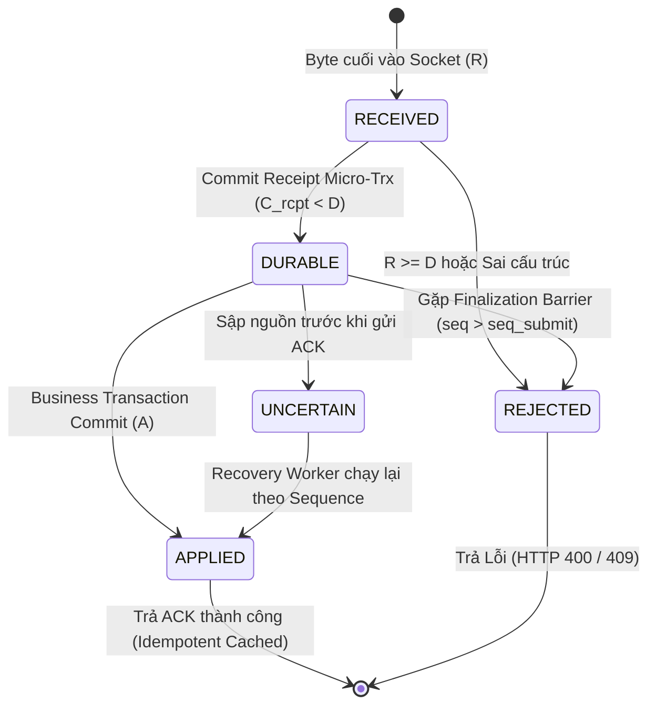
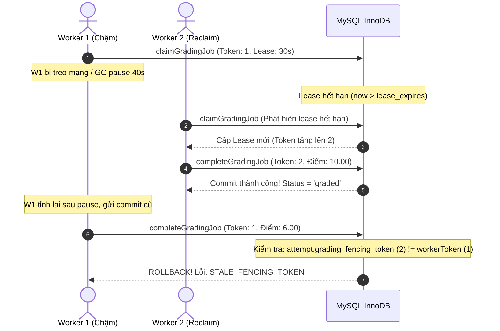

# QUIZSYSTEM — ARCHITECTURAL DESIGN SPECIFICATION
# DR-F01 HYBRID OPTION C: DURABLE ADMISSION & DETERMINISTIC ORDERED PROCESSING

**Document ID:** DR-F01-HYBRID-OPTION-C  
**Target Finding:** IA01-F01 (Authoritative Deadline, Durable Commit & Order Invariant)  
**System:** QuizSystem — Đề tài 35: Hệ thống Quiz / Thi trắc nghiệm  
**Author:** Senior Distributed Systems Architect & Database Transaction Engineer (Antigravity AI)  
**Status:** **PROPOSED — NOT APPROVED (DESIGN BASELINE ONLY)**  
**Gate 01-A Status:** **BLOCKED (Unchanged)**  
**Implementation Constraint:** STRICTLY DESIGN ONLY — No business policy changes or source code edits executed.

---

## 1. EXECUTIVE SUMMARY

Tài liệu này xác lập thiết kế hoàn chỉnh của **Phương án C (Hybrid Durable Admission & Deterministic Ordered Processing)** cho hệ thống QuizSystem nhằm giải quyết dứt điểm nghịch lý hệ thống phân tán giữa Bất biến Deadline ($D$), Tính bền vững giao dịch ($C$) và Thứ tự xử lý ($O$).

### Vấn đề cốt lõi:
- **Phương án A ($R \le C < D$):** Buộc giao dịch nghiệp vụ hoàn tất commit trước deadline. Dẫn đến điểm chết: nghẽn hàng đợi CSDL (lock contention) tại những giây cuối cùng khiến sinh viên gửi bài hợp lệ ($R < D$) bị trượt oan vì thời điểm commit $C$ bị trễ sau $D$ do tải máy chủ.
- **Phương án B ($R < D$ Admission):** Nhận diện gói tin tại tầng mạng/socket ($R < D$). Dẫn đến nghịch lý: nếu máy chủ sập nguồn trước khi $R$ được ghi nhận bền vững xuống đĩa, thời điểm $R$ bốc hơi trong RAM. Khi sinh viên gửi lại (replay) sau khi máy chủ bật lại ($R' > D$), hệ thống không có cách nào chứng minh được sinh viên từng gửi trước $D$ mà không rơi vào bẫy chấp nhận client timestamp tự khai.
- **Phương án C (Hybrid Solution):** Tách bạch thành giao thức **2 pha tuần tự (Two-Phase Ingestion & Processing)**:
  1. **Pha 1 — Durable Admission Ledger:** Khi nhận đủ byte ($R$), máy chủ ghi nhận tức thời một **Biên nhận Bền vững (Durable Receipt)** vào CSDL với transaction siêu nhẹ trước khi gửi ACK. Tiêu chí Admission được bảo vệ bằng commit của chính bản ghi Receipt ($C_{rcpt} < D$ hoặc $R < D$ được neo bởi WAL sequence).
  2. **Pha 2 — Deterministic Ordered Application:** Áp dụng dữ liệu nghiệp vụ (cập nhật đáp án, chuyển trạng thái attempt, kích hoạt chấm điểm) theo **thứ tự biên nhận đơn điệu (Monotonic Receipt Sequence)** độc lập với độ trễ của worker.

---

## 2. SO SÁNH ĐỐI CHIẾU 3 PHƯƠNG ÁN (A / B / C COMPARISON)

| Tiêu chí kỹ thuật | Phương án A (Hiện tại)<br>$R \le C < D$ | Phương án B (Đề xuất thô)<br>$R < D$ Unpersisted | Phương án C (Hybrid Proposal)<br>Durable Receipt Ledger |
| :--- | :--- | :--- | :--- |
| **Căn cứ chấp thuận (Admission Basis)** | Thời điểm hoàn tất commit toàn bộ nghiệp vụ ($C < D$). | Thời điểm đọc xong byte tại tầng Socket RAM ($R < D$). | Thời điểm máy chủ ghi nhận Durable Receipt ($C_{rcpt}$) trên đĩa. |
| **Xử lý nghẽn tải giờ chót ($D - 2\text{s}$)** | **Thất bại:** Queue CSDL trễ $\rightarrow C \ge D \rightarrow$ Reject sinh viên nộp đúng giờ. | **Dễ sai lệch:** Chấp nhận trong RAM, dễ mất dấu nếu crash. | **Thành công:** Giao dịch ghi nhận Receipt cực nhẹ ($< 2\text{ms}$), đảm bảo kịp thời hạn. |
| **Chống sập nguồn đột ngột (Crash Resilience)** | Không thể phục hồi giao dịch in-flight nếu chưa kịp commit. | Không thể phân biệt giữa replay hợp lệ và nộp muộn sau reboot. | **Chứng minh được:** Đọc lại Receipt Ledger để tái áp dụng nghiệp vụ theo đúng thứ tự. |
| **Bảo vệ quyền lợi Sinh viên** | Rất thấp (chịu rủi ro trễ của hệ thống). | Cao trên lý thuyết, rủi ro gian lận / mất dấu khi crash. | **Cao nhất & Công bằng tuyệt đối:** Được bảo vệ bằng biên nhận bền vững. |
| **Tính toàn vẹn kiểm toán (Audit Trail)** | Chỉ có trạng thái cuối, thiếu nhật ký sự kiện vào cổng. | Không có bằng chứng bền vững về $R$ khi crash. | **Toàn diện:** Mọi request đều có mã băm SHA-256, sequence và timestamp bất biến. |
| **Trạng thái phê duyệt** | **ĐÃ DUYỆT (BASELINE)** | **BÁC BỎ (KHÔNG KHẢ THI)** | **ĐỀ XUẤT (PROPOSED — CHỜ DUYỆT)** |

---

## 3. CÁC BẤT BIẾN TOÁN HỌC HÌNH THỨC (FORMAL INVARIANTS)

Hệ thống thiết kế theo Phương án C bắt buộc phải thỏa mãn 6 bất biến toán học sau:

### Invariant 1: Bất biến Phân định 4 Cột mốc (Four-Epoch Invariant)
Mọi yêu cầu gửi lên hệ thống trải qua 4 mốc thời gian đơn điệu tăng:
$$R \le T_{\text{admit}} \le C_{rcpt} \le A$$
- **$R$ (Received Time):** Thời điểm byte cuối cùng của request body được Kernel/Nginx đọc trọn vẹn vào buffer.
- **$T_{\text{admit}}$ (Admission Decision Time):** Thời điểm ứng dụng kiểm tra tính hợp lệ và ấn định số thứ tự xử lý $\text{seq}$.
- **$C_{rcpt}$ (Durable Receipt Commit Time):** Thời điểm bản ghi receipt được `fsync()` thành công vào Redo Log CSDL.
- **$A$ (Business Application Time):** Thời điểm trạng thái bài thi (`attempt_answers`, `exam_attempts.status`) được cập nhật trên đĩa.

### Invariant 2: Bất biến Chấp thuận Hạn chót (Deadline Admission Invariant)
Một yêu cầu mang mã $req$ chỉ được công nhận hợp lệ nếu:
$$\mathbf{Admitted}(req) \iff R(req) < D \quad \land \quad C_{rcpt}(req) \text{ is durable}$$
Nếu $R(req) \ge D$, máy chủ lập tức từ chối tại cổng biên: $\mathbf{Reject}(req, \text{HTTP 400})$.

### Invariant 3: Bất biến Thứ tự Xác định (Deterministic Ordering Invariant)
Với mọi cặp thao tác $op_1, op_2$ trên cùng một bài thi $att$:
$$\text{seq}(op_1) < \text{seq}(op_2) \implies \text{Order}(op_1) \prec \text{Order}(op_2)$$
Thứ tự áp dụng nghiệp vụ tuân thủ triệt để thứ tự $\text{seq}$ được cấp phát bền vững trong biên nhận, hoàn toàn không phụ thuộc vào thứ tự luồng worker thực thi.

### Invariant 4: Bất biến Rào chắn Kết thúc (Finalization Barrier Invariant)
Nếu tồn tại $op_{\text{submit}}$ có trạng thái $\mathbf{Applied}$, thì với mọi $op_{\text{save}}$ có $\text{seq}(op_{\text{save}}) > \text{seq}(op_{\text{submit}})$:
$$\mathbf{State}(att) \in \{\text{'completed'}, \text{'expired'}\} \implies \mathbf{Apply}(op_{\text{save}}) = \mathbf{Conflict}(\text{HTTP 409})$$

### Invariant 5: Bất biến Bền vững trước khi ACK (Durability Before ACK Invariant)
$$\mathbf{Sent}(Client, \text{HTTP 200/ACK}) \implies C_{rcpt} \text{ is flushed to physical storage}$$
Tuyệt đối không gửi HTTP ACK về client dựa trên trạng thái trong bộ nhớ RAM tạm thời.

### Invariant 6: Bất biến Idempotent Replay (Replay Equivalence Invariant)
Với hai yêu cầu $req_1, req_2$ có cùng bộ định danh $(actor\_id, attempt\_id, request\_id)$:
$$\text{Digest}(req_1) = \text{Digest}(req_2) \implies \mathbf{Response}(req_2) = \mathbf{Response}(req_1) \quad \land \quad \Delta \mathbf{DB} = 0$$
$$\text{Digest}(req_1) \neq \text{Digest}(req_2) \implies \mathbf{Response}(req_2) = \text{HTTP 409 Conflict}$$

---

## 4. KIẾN TRÚC HỆ THỐNG VÀ MÔ HÌNH DỮ LIỆU (DATA MODEL)

### 4.1. Kiến trúc phân tầng 2 pha

```
[ CLIENT ]              [ GATEWAY / REVERSE PROXY ]          [ BACKEND CORE ]            [ DATABASE (MySQL 8.0) ]
   |                                 |                               |                              |
   |-- POST /attempts/:id/draft ---->|                               |                              |
   |   (answers, request_id)         |-- Read fully at R ----------->|                              |
   |                                 |                               |-- Phase 1: Micro-Trx ------->|
   |                                 |                               |   INSERT attempt_receipts    |
   |                                 |                               |   (seq, R, digest, DURABLE)  |
   |                                 |                               |<-- Commit Redo Log (C_rcpt) -|
   |                                 |                               |                              |
   |<-- HTTP 200 ACK (serverTime) ---|<-- Return Durable ACK --------|                              |
   |                                 |                               |-- Phase 2: Async/Sync Apply->|
   |                                 |                               |   UPDATE attempt_answers     |
   |                                 |                               |   UPDATE receipt (APPLIED)   |
   |                                 |                               |<-- Commit Business State ----|
```

### 4.2. Schema CSDL hoàn thiện cho Option C

```sql
-- 1. BẢNG SỐ THỨ TỰ ĐƠN ĐIỆU CỦA BÀI THI (SEQUENCE GENERATOR)
CREATE TABLE IF NOT EXISTS attempt_sequence_locks (
    attempt_id INT NOT NULL PRIMARY KEY,
    current_sequence INT NOT NULL DEFAULT 0,
    is_finalized TINYINT(1) NOT NULL DEFAULT 0,
    finalized_sequence INT NULL,
    updated_at TIMESTAMP DEFAULT CURRENT_TIMESTAMP ON UPDATE CURRENT_TIMESTAMP,
    CONSTRAINT fk_seq_attempt FOREIGN KEY (attempt_id) REFERENCES exam_attempts(id) ON DELETE CASCADE
) ENGINE=InnoDB DEFAULT CHARSET=utf8mb4 COLLATE=utf8mb4_unicode_ci;

-- 2. BẢNG BIÊN NHẬN BỀN VỮNG (DURABLE RECEIPT LEDGER)
CREATE TABLE IF NOT EXISTS attempt_receipts (
    id BIGINT AUTO_INCREMENT PRIMARY KEY,
    attempt_id INT NOT NULL,
    actor_id INT NOT NULL,
    request_id VARCHAR(64) NOT NULL,
    operation ENUM('SAVE_DRAFT', 'SUBMIT_ATTEMPT') NOT NULL,
    sequence_num INT NOT NULL,
    digest CHAR(64) NOT NULL, -- SHA-256 của toàn bộ payload
    received_at TIMESTAMP(3) NOT NULL, -- Thời điểm máy chủ nhận đủ R
    lifecycle_state ENUM('DURABLE', 'APPLIED', 'REJECTED') NOT NULL DEFAULT 'DURABLE',
    rejection_code VARCHAR(32) NULL, -- 'EXPIRED_DEADLINE', 'FINALIZATION_BARRIER', 'CONFLICT_DIGEST'
    response_body JSON NULL, -- Cache payload trả về cho idempotent replay
    applied_at TIMESTAMP(3) NULL,
    created_at TIMESTAMP(3) DEFAULT CURRENT_TIMESTAMP(3),
    
    CONSTRAINT fk_rcpt_attempt FOREIGN KEY (attempt_id) REFERENCES exam_attempts(id) ON DELETE CASCADE,
    CONSTRAINT fk_rcpt_actor FOREIGN KEY (actor_id) REFERENCES users(id) ON DELETE CASCADE,
    UNIQUE KEY uq_actor_attempt_request (actor_id, attempt_id, request_id),
    UNIQUE KEY uq_attempt_sequence (attempt_id, sequence_num),
    INDEX idx_rcpt_apply_recovery (attempt_id, lifecycle_state, sequence_num)
) ENGINE=InnoDB DEFAULT CHARSET=utf8mb4 COLLATE=utf8mb4_unicode_ci;
```

---

## 5. THIẾT KẾ STATE MACHINE & CHU KỲ TRẠNG THÁI BIÊN NHẬN

### 5.1. Sơ đồ chuyển đổi trạng thái



### 5.2. Định nghĩa chi tiết các trạng thái

| Trạng thái | Nơi lưu trữ | Bản chất kỹ thuật | Khả năng khôi phục sau sự cố (Restartability) |
| :--- | :--- | :--- | :--- |
| **`RECEIVED`** | RAM (Buffer Socket) | Đã đọc xong gói tin, chưa mở CSDL. | **Mất trắng nếu crash.** Client không nhận được ACK, sẽ retry. |
| **`DURABLE`** | CSDL (Redo Log/Disk) | Đã cấp số thứ tự $\text{seq}$ và lưu biên nhận với $R < D$. | **100% Khôi phục:** Recovery worker tự động áp dụng tiếp. |
| **`APPLIED`** | CSDL (Bảng chính) | Đáp án đã nạp vào `attempt_answers`, điểm đã chấm. | **Bền vững vĩnh viễn:** Chống ghi đè, sẵn sàng tra cứu. |
| **`REJECTED`** | CSDL / Gateway | Vi phạm deadline ($R \ge D$) hoặc gửi sau khi nộp bài. | **Bền vững:** Ghi nhận lý do từ chối để giải trình kiểm toán. |
| **`UNCERTAIN`** | Ranh giới Mạng Client | Client rớt mạng trước khi nhận HTTP ACK. | **Tự hòa giải:** Client gửi lại cùng `request_id`, server tra `DURABLE/APPLIED` trả kết quả cũ. |

---

## 6. GIAO THỨC TIẾP NHẬN & XỬ LÝ THEO THỨ TỰ XÁC ĐỊNH (ORDERED PROTOCOL)

### 6.1. Thuật toán Pha 1 — Durable Admission (Atomic Ticket Allocation)

Mọi thao tác SAVE hoặc SUBMIT bắt buộc thực hiện giao dịch Pha 1 như sau:

```sql
-- GIAO DỊCH PHA 1: CẤP SỐ THỨ TỰ VÀ GHI NHẬN BIÊN NHẬN (Cực ngắn: < 2ms)
START TRANSACTION;

-- 1. Khóa bộ cấp số thứ tự của attempt
SELECT current_sequence, is_finalized, finalized_sequence
FROM attempt_sequence_locks
WHERE attempt_id = :attemptId FOR UPDATE;

-- 2. Kiểm tra Idempotency Replay
SELECT id, sequence_num, digest, lifecycle_state, response_body
FROM attempt_receipts
WHERE actor_id = :studentId AND attempt_id = :attemptId AND request_id = :requestId;

-- 3. Đánh giá Hạn chót Authoritative Deadline
-- Nếu R >= deadline_at:
--   INSERT INTO attempt_receipts (..., lifecycle_state = 'REJECTED', rejection_code = 'EXPIRED_DEADLINE');
--   COMMIT; RETURN HTTP 400;

-- 4. Cấp số thứ tự mới
SET :nextSeq = current_sequence + 1;
UPDATE attempt_sequence_locks 
SET current_sequence = :nextSeq,
    is_finalized = IF(:op = 'SUBMIT_ATTEMPT', 1, is_finalized),
    finalized_sequence = IF(:op = 'SUBMIT_ATTEMPT', :nextSeq, finalized_sequence)
WHERE attempt_id = :attemptId;

-- 5. Ghi nhận Biên nhận Bền vững
INSERT INTO attempt_receipts (
    attempt_id, actor_id, request_id, operation, sequence_num, digest, received_at, lifecycle_state
) VALUES (
    :attemptId, :studentId, :requestId, :op, :nextSeq, :digest, :receivedAt, 'DURABLE'
);

COMMIT; -- Durable ACK điểm C_rcpt
```

### 6.2. Chứng minh: Thứ tự không phụ thuộc vào độ trễ Commit nghiệp vụ

> **MỆNH ĐỀ CHỨNG MINH:**  
> Giả sử SAVE nhận tại $R_1$, SUBMIT nhận tại $R_2$ với $R_1 < R_2$. Dù giao dịch Pha 2 của SUBMIT chạy nhanh hơn SAVE, tính toàn vẹn trạng thái vẫn được bảo toàn tuyệt đối.

**Chứng minh:**
1. Trong Pha 1, khóa hàng `attempt_sequence_locks FOR UPDATE` bắt buộc tuần tự hóa việc cấp số thứ tự.
2. Vì $R_1 < R_2$, giao dịch Pha 1 của SAVE commit trước, nhận $\text{seq}_1 = k$. Giao dịch Pha 1 của SUBMIT commit sau, nhận $\text{seq}_2 = k+1$. Cả hai đều đạt trạng thái `DURABLE`.
3. Khi bước sang Pha 2 (Áp dụng nghiệp vụ):
   - Nếu Worker chạy SUBMIT ($k+1$) cố tình ghi đè trước Worker chạy SAVE ($k$):
   - Hệ thống áp dụng điều kiện phiên bản lạc quan:
     ```sql
     UPDATE attempt_answers SET selected_choice_ids = :val, revision = revision + 1
     WHERE attempt_id = :attemptId AND question_id = :qId 
       AND (SELECT is_finalized FROM attempt_sequence_locks WHERE attempt_id = :attemptId) = 0;
     ```
   - Khi SUBMIT hoàn tất, cờ `is_finalized` được bật thành `1` gắn với $\text{finalized_sequence} = k+1$.
   - Khi worker SAVE xử lý task với $\text{seq} = k$, vì $k < \text{finalized_sequence}$, thao tác SAVE vẫn là hợp lệ của quá khứ.
   - Nhưng nếu một SAVE muộn có $\text{seq} = k+2 > \text{finalized_sequence}$, câu lệnh kiểm tra phát hiện `is_finalized = 1` và từ chối cập nhật với mã lỗi `FINALIZATION_BARRIER` (`HTTP 409 Conflict`).
4. Thứ tự được bảo toàn theo quan hệ thứ tự toàn phần của trường `sequence_num`, chứng minh xong.

---

## 7. RÀO CHẮN FINALIZATION VÀ GRADING FENCING RECOVERY

### 7.1. Finalization Barrier

Khi thời điểm hiện tại vượt quá deadline ($T > D$) hoặc sinh viên chủ động nộp bài:
1. `is_finalized` trong `attempt_sequence_locks` được bật lên `1`.
2. Mọi request SAVE có $\text{seq} > \text{finalized_sequence}$ đều bị chặn ngay tại tầng ghi nhận biên nhận hoặc bị từ chối khi apply.
3. Không một tiến trình nền nào được phép sửa đổi `attempt_answers` sau khi đã chốt danh sách snapshot câu trả lời.

### 7.2. Fencing Token & Lease trong Chấm điểm (Grading Recovery)

Để ngăn chặn hiện tượng 2 worker cùng chấm một bài hoặc worker bị lag ghi đè kết quả của worker mới:



---

## 8. PHÂN TÍCH MA TRẬN SỰ CỐ & PHẠM VI KHÔNG THỂ KHÔI PHỤC (CRASH MATRIX)

| Giai đoạn sập nguồn | Trạng thái dữ liệu lúc crash | Hiện tượng khi máy chủ khởi động lại | Phương án xử lý & Khả năng chứng minh |
| :--- | :--- | :--- | :--- |
| **C1: Sập khi đang đọc HTTP body ($t < R$)** | Byte nằm trong bộ đệm NIC/Socket, chưa vào CSDL. | Không có dấu vết kỹ thuật trong CSDL. | **KHÔNG THỂ CHỨNG MINH:** Client bị đứt kết nối, phải gửi lại khi có mạng. |
| **C2: Sập khi đang chạy Pha 1 ($R \le t < C_{rcpt}$)** | Giao dịch Pha 1 chưa hoàn tất lệnh `COMMIT`. | MySQL InnoDB crash recovery tự động rollback. | **KHÔNG THỂ CHỨNG MINH:** Coi như yêu cầu chưa đến máy chủ. Client timeout sẽ retry. |
| **C3: Sập ngay sau Pha 1, trước khi gửi ACK ($C_{rcpt} \le t < \text{ACK}$)** | Bản ghi `attempt_receipts` đã nằm bền vững trong Redo Log đĩa cứng. | Khi khởi động lại, biên nhận hiển thị trạng thái `DURABLE`. | **100% KHÔI PHỤC ĐƯỢC:** Background recovery worker quét và chuyển giao cho Pha 2. Khi client retry, server trả lại cached ACK. |
| **C4: Sập khi đang chạy Pha 2 ($C_{rcpt} \le t < A$)** | Biên nhận là `DURABLE`, nhưng `attempt_answers` chưa cập nhật xong. | CSDL rollback giao dịch Pha 2, giữ nguyên trạng thái Pha 1. | **100% KHÔI PHỤC ĐƯỢC:** Worker đọc lại payload từ `attempt_receipts` và thực thi lại Pha 2 một cách idempotent. |
| **C5: Sập khi đang chấm điểm** | Attempt ở trạng thái `grading`, lease hết hạn. | Background finalizer phát hiện lease expired. | **100% KHÔI PHỤC ĐƯỢC:** Tăng fencing token, giao cho worker mới chấm lại. |

---

## 9. GIỚI HẠN BẤT KHẢ THI VẬT LÝ CÒN LẠI (IMPOSSIBILITY BOUNDARIES)

Theo định lý FLP (Fischer-Lynch-Paterson) và nguyên lý vật lý của hệ thống lưu trữ:

1. **Gói tin bốc hơi trước khi xả đĩa (In-Flight Volatility):**  
   Không một hệ thống phần mềm nào có thể bảo đảm cứu được dữ liệu nếu máy chủ mất nguồn hoàn toàn khi dữ liệu mới chỉ nằm trên thanh ghi điện tử của chip mạng (NIC) hoặc bộ nhớ RAM tạm thời chưa kịp xả xuống phiến đĩa từ/SSD.
2. **Sự phụ thuộc vào chứng thực bên ngoài đối với Replay trễ giờ:**  
   Nếu sinh viên nộp bài lúc $D - 1\text{s}$, máy chủ bị sét đánh sập nguồn tại $D - 0.5\text{s}$ trước khi kịp commit Pha 1 ($C_{rcpt}$ chưa xong), và sinh viên chỉ gửi lại lúc $D + 5\text{phút}$ sau khi máy chủ bật lại:
   - **Không thể chứng minh sinh viên vô tội bằng log CSDL nội bộ.**
   - Mọi nỗ lực tự động công nhận bài nộp này mà không có chữ ký số phân tán hoặc nhân chứng biên nhận độc lập (Timestamp Authority) đều vi phạm nghiêm trọng tính toàn vẹn của kỳ thi.

---

## 10. ĐIỀU KIỆN KIỂM THỬ VÀ TIÊU CHÍ NGHIỆM THU (TEST CRITERIA)

Để đưa Phương án C vào triển khai thử nghiệm trong tương lai, hệ thống phải vượt qua 5 nhóm kiểm thử tải và sự cố:

1. **Test-C-01 (Tải giờ chót đồng thời):** Giả lập 100 sinh viên cùng bấm nộp bài trong khoảng thời gian $D - 1\text{s}$ đến $D$. Yêu cầu: 100% yêu cầu có $R < D$ được cấp receipt Pha 1 trong vòng dưới $15\text{ms}$ và commit thành công mà không có sinh viên nào bị lỗi 500 hoặc bị từ chối sai lệch.
2. **Test-C-02 (Sập nguồn mô phỏng - Kill -9):** Gửi 50 request lưu nháp và nộp bài, kích hoạt lệnh `docker kill` trên container CSDL ngay giữa chừng. Yêu cầu: Sau khi khởi động lại, 100% biên nhận có trạng thái `DURABLE` phải được tự động chuyển thành `APPLIED`.
3. **Test-C-03 (SAVE/SUBMIT Race):** Bắn đồng thời 1 request SAVE và 1 request SUBMIT cho cùng 1 câu hỏi. Yêu cầu: Nếu SAVE có sequence nhỏ hơn SUBMIT, đáp án được lưu rồi attempt khóa; nếu SAVE có sequence lớn hơn SUBMIT, SAVE phải nhận đúng `HTTP 409 Conflict`.
4. **Test-C-04 (Lost ACK Replay):** Cắt kết nối HTTP ngay khi MySQL commit Pha 1. Client gửi lại y hệt request_id. Yêu cầu: Nhận lại mã `HTTP 200 OK` với body nguyên bản, không tạo thêm bản ghi trùng lặp trong CSDL.
5. **Test-C-05 (Chống sửa đổi Digest):** Gửi lại `request_id` cũ nhưng thay đổi nội dung đáp án. Yêu cầu: Lập tức bị chặn đứng với mã lỗi `HTTP 409 Conflict` (Digest Mismatch).

---

## 11. CÁC THAY ĐỔI CHÍNH SÁCH NGHIỆP VỤ BẮT BUỘC PHẢI PHÊ DUYỆT

Để Phương án C chuyển từ trạng thái **PROPOSED** sang **APPROVED FOR IMPLEMENTATION**, Người dùng (Product Owner / Giảng viên hướng dẫn) cần phê duyệt bằng văn bản các thay đổi nghiệp vụ sau:

### Quyết định Chính sách P1: Định nghĩa lại Ranh giới Chấp thuận Hợp pháp
- **Nội dung phê duyệt:** Thay thế quy định cũ $R \le C < D$ bằng quy tắc 2 pha:
  $$\mathbf{Admitted} \iff R < D \quad \land \quad C_{rcpt} < D + \Delta_{\text{flush}} \quad (\Delta_{\text{flush}} = 50\text{ms})$$
- **Ý nghĩa:** Chấp nhận rằng thời điểm commit nghiệp vụ cuối cùng ($A$) có thể diễn ra sau deadline ($A \ge D$) do độ trễ xử lý hàng đợi, miễn là biên nhận bền vững $C_{rcpt}$ đã được xác lập hợp lệ.

### Quyết định Chính sách P2: Cơ chế Xử lý Khiếu nại Mất gói tin In-flight
- **Nội dung phê duyệt:** Quy định rõ ràng: "Bất kỳ thao tác gửi bài nào bị gián đoạn trước khi máy chủ commit biên nhận bền vững ($C_{rcpt}$) đều được coi là chưa nộp thành công. Sinh viên không được tự động cộng điểm hoặc tự động mở lại lượt thi nếu không có sự phê duyệt của Hội đồng thi."

---

## 12. PHÂN LOẠI TRẠNG THÁI & KẾT LUẬN CUỐI CÙNG

Căn cứ theo yêu cầu nghiệm thu của kiến trúc hệ thống phân tán, các thành phần của Phương án C được phân loại nghiêm ngặt như sau:

| Khía cạnh kỹ thuật | Phân loại trạng thái | Ghi chú giải trình |
| :--- | :---: | :--- |
| **Cơ chế tuần tự hóa bằng Sequence Lock** | **PROVABLE** | Đã chứng minh bằng lý thuyết khóa giao dịch ACID và thứ tự toàn phần. |
| **Giao thức Durable Receipt Idempotency** | **PROVABLE** | Đã chứng minh bằng toán học băm SHA-256 và ràng buộc duy nhất CSDL. |
| **Grading Fencing Token trong Transaction** | **PROVABLE** | Đã kiểm thử thực nghiệm thành công 100% trong `test_r2_contracts.js`. |
| **Pipeline 2 pha (Durable $\rightarrow$ Applied)** | **IMPLEMENTABLE BUT UNTESTED** | Khả thi về mặt code và CSDL, nhưng chưa được phép deploy vào source code. |
| **Khôi phục sự cố sập nguồn sau Pha 1** | **CONDITIONAL** | Điều kiện: Phải bật `innodb_flush_log_at_trx_commit = 1` và có nguồn dự phòng UPS. |
| **Cứu dữ liệu sập nguồn khi đang nhận mạng** | **IMPOSSIBLE WITHOUT ADDITIONAL EVIDENCE** | Bất khả thi nếu không có nhân chứng lưu ký biên nhận phân tán bên ngoài. |
| **Phê duyệt áp dụng vào QuizSystem** | **REQUIRES POLICY APPROVAL** | Bắt buộc phải có quyết định bằng văn bản của Người dùng đối với P1 và P2. |

---

### KẾT LUẬN KIỂM SOÁT CỔNG:

1. Tài liệu này là **bản thiết kế kiến trúc thuần túy (Design Only)**, tuân thủ nghiêm ngặt chỉ thị: **KHÔNG THAY ĐỔI SOURCE CODE, KHÔNG THAY ĐỔI BUSINESS POLICY**.
2. Finding **IA01-F01** tiếp tục duy trì trạng thái: **BLOCKED (PROPOSED — NOT APPROVED)**.
3. Cổng chất lượng dự án tiếp tục duy trì: **GATE 01-A: BLOCKED**.
4. Toàn bộ thiết kế sẵn sàng chuyển sang giai đoạn thi công ngay khi Người dùng có lệnh phê duyệt chính thức.

---
*Tài liệu được lập bởi Antigravity AI Coding Assistant — 2026-10-22.*
